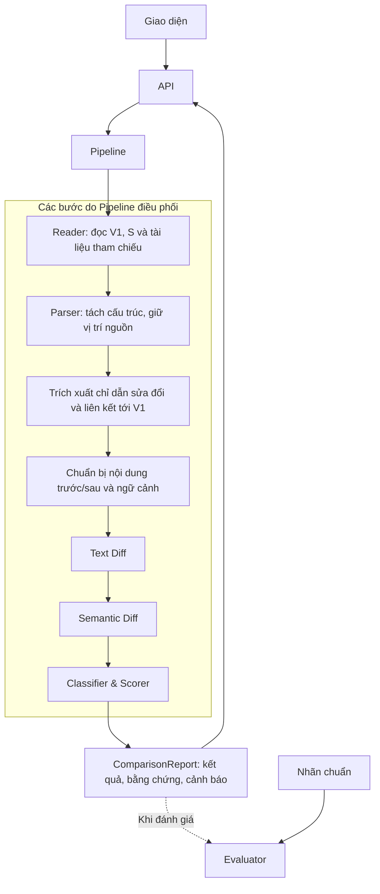

 <h1 align="center">Group 4 – Legal Document Change Detection</h1>

* **Đề tài:** Project 7 – Legal Document Change Detection (Engineering / R&D )
* **Bài toán:** Phát hiện và giải thích các thay đổi có ý nghĩa pháp lý từ văn bản sửa đổi S đối với văn bản gốc V1, có thể sử dụng tài liệu tham chiếu do người dùng cung cấp. Kết quả cần giữ bằng chứng, vị trí nguồn và cảnh báo khi chưa đủ thông tin.

**Tài liệu dự án (Yêu cầu đọc theo thứ tự):**
1. [BRD](brd.md): mục tiêu và phạm vi.
2. [SRS](srs.md): yêu cầu và hợp đồng dữ liệu.
3. [Architecture](architecture.md): thiết kế module và luồng xử lý.
4. [Implementation Plan](implementation-plan.md): công nghệ,
   phân công và tiến độ triển khai.
5. Mã nguồn: baseline hiện tại.

---

## 1. Kiến trúc mục tiêu

Các module xử lý nằm trong cùng một backend Python. Pipeline gọi các
module theo thứ tự và gom kết quả thành ComparisonReport.

Luồng xử lý dự kiến:

1. Reader đọc văn bản gốc V1, văn bản sửa đổi S và tài liệu tham chiếu.
2. Parser tách cấu trúc tài liệu, giữ liên kết tới vị trí nguồn.
3. Bộ trích xuất xác định chỉ dẫn sửa đổi trong S; bộ liên kết xác định
   phần tương ứng trong V1.
4. Chuẩn bị nội dung trước/sau và ngữ cảnh, ghi nhận thông tin còn thiếu.
5. Text Diff xác định thay đổi về chữ; Semantic Diff phân tích ý nghĩa.
6. Classifier & Scorer phân loại và đánh giá mức độ thay đổi.
7. Pipeline tổng hợp báo cáo, bằng chứng và các cảnh báo cần kiểm tra.

Backend xử lý và trả báo cáo trong cùng một request đồng bộ.
Evaluator chạy riêng để đối chiếu kết quả với nhãn chuẩn.

Đây là kiến trúc mục tiêu. Pipeline baseline hiện tại chưa triển khai
đầy đủ luồng này.



Sơ đồ mô tả kiến trúc mục tiêu. Các bước xử lý chạy trong cùng
backend Python; pipeline baseline hiện chưa triển khai đầy đủ.

## 2. Mục tiêu Hệ thống & Chỉ số Nghiệm thu (Targets)
- Change F1 ≥ 0,90: đo khả năng phát hiện từng thay đổi nghĩa.
- Critical Change Recall ≥ 0,95: tìm đúng ít nhất 95% thay đổi
  được gán nhãn CRITICAL theo bộ tiêu chí thống nhất.
- Đo trên bộ kiểm thử độc lập; đây là mục tiêu, chưa phải kết quả đạt được.

## 3. Cấu trúc thư mục

Các đường dẫn dưới đây tính từ thư mục gốc repository.

| Đường dẫn | Vai trò |
|---|---|
| `backend/main.py` | Khởi tạo ứng dụng FastAPI và endpoint baseline |
| `backend/app/api/` | Nơi phát triển các endpoint; hiện mới có khung package |
| `backend/app/schemas/contracts.py` | Các kiểu dữ liệu dùng chung |
| `backend/app/schemas/validation.py` | Kiểm tra dữ liệu tại thời điểm chạy |
| `backend/app/document_processing/` | Nhóm xử lý đầu vào và cấu trúc tài liệu |
| `backend/app/document_processing/parser/doc_parser.py` | Parser baseline đang được pipeline gọi |
| `backend/app/change_analysis/aligner/` | Ghép cặp đơn vị văn bản của baseline |
| `backend/app/change_analysis/semantic_diff/` | Phân tích thay đổi ý nghĩa của baseline |
| `backend/app/change_analysis/classifier_scorer/` | Phân loại và đánh giá mức độ của baseline |
| `backend/app/pipeline.py` | Điều phối luồng xử lý baseline |
| `src/evaluation/` | Evaluator hiện tại; chưa chuyển trong lần sắp xếp này |
| `tests/` | Kiểm thử và JSON mẫu dùng chung |
| `frontend/` | Nơi phát triển giao diện |
| `docs/` | Tài liệu yêu cầu, kiến trúc và kế hoạch |
| `data/` | Tài liệu mẫu và dữ liệu thử |

### Quy ước khi phát triển

- Dùng schema chung tại `backend/app/schemas/contracts.py`.
- Khi đổi trường dữ liệu dùng chung, trao đổi với các thành viên đang
  sử dụng trường đó trước khi tích hợp.
- Import phải chỉ đúng module chứa hàm hoặc kiểu dữ liệu.
- Chạy các lệnh từ thư mục gốc repository.
- Lần sắp xếp này chuyển vị trí code và sửa import; giữ nguyên thuật toán
  baseline. Các thành viên cần cập nhật đường dẫn khi tích hợp nhánh.

Ví dụ import:

```python
from backend.app.schemas.contracts import Clause
from backend.app.change_analysis.aligner.version_aligner import align_versions
from backend.app.pipeline import run_pipeline
```

## Hiện trạng triển khai

- Các module chính của baseline đã được chuyển vào backend/app/.
- Schema đã bổ sung hợp đồng dữ liệu phục vụ Reader/Parser và chỉ dẫn
sửa đổi; chưa coi toàn bộ schema của hệ thống là hoàn tất.
- Có validator cho ExtractedDocument và 4 kiểm thử validation.
Validator chưa được nối vào pipeline.
- Pipeline hiện chạy ví dụ baseline với hai chuỗi văn bản.
Chưa hoàn thiện luồng xử lý V1 và văn bản sửa đổi S theo SRS.
- API hiện nhận hai chuỗi doc_v1 và doc_v2; chưa hỗ trợ upload file.
- Semantic Diff và Scorer hiện dùng quy tắc đơn giản.
- Các công cụ đọc/chuyển đổi/phân tách tài liệu được phát triển riêng;
việc có file trong repository chưa đồng nghĩa đã tích hợp vào pipeline.
- Thư mục api/ mới được chuẩn bị cho các bước phát triển tiếp theo.

---

## 4. Hướng dẫn cài đặt và chạy thử

Chạy các lệnh dưới đây tại **thư mục gốc repository**, nơi chứa
các thư mục `backend/`, `docs/` và `tests/`.

Các lệnh sử dụng CMD trên Windows.

### 4.1. Chuẩn bị môi trường

Nếu chưa có môi trường ảo `.venv`, tạo bằng lệnh:

```bat
python -m venv .venv
```

Cài các thư viện của dự án vào môi trường ảo:

```bat
.\.venv\Scripts\python.exe -m pip install -r requirements.txt
```

Các lệnh bên dưới gọi trực tiếp Python trong `.venv`, vì vậy không cần
kích hoạt môi trường ảo trước khi chạy.

### 4.2. Chạy pipeline baseline

```bat
.\.venv\Scripts\python.exe -m backend.app.pipeline
```

Lệnh này chạy ví dụ có sẵn trong pipeline và in kết quả ra terminal.

Pipeline hiện xử lý hai chuỗi văn bản mẫu. Đây chưa phải luồng upload
và phân tích đầy đủ văn bản gốc V1 với văn bản sửa đổi S theo SRS.

### 4.3. Chạy kiểm thử validation

```bat
.\.venv\Scripts\python.exe -m unittest discover -s tests -p test_validation.py -v
```

Bộ kiểm thử hiện có 4 trường hợp:

- Chấp nhận tài liệu có dữ liệu hợp lệ.
- Từ chối tài liệu thiếu trường bắt buộc `document_id`.
- Từ chối tài liệu có `source_ref` trùng nhau.
- Từ chối tài liệu không có nội dung chữ đọc được.

Kết quả mong đợi: 4 test chạy thành công và xuất hiện `OK`.

Các test này kiểm tra validation của `ExtractedDocument`, chưa đại diện
cho kiểm thử toàn bộ hệ thống.

### 4.4. Khởi chạy API baseline

Môi trường cần có FastAPI và Uvicorn.

```bat
.\.venv\Scripts\python.exe -m uvicorn backend.main:app --reload
```

Sau khi server khởi động, mở:

http://127.0.0.1:8000/docs

Endpoint hiện tại:

- Phương thức: `POST`
- Đường dẫn: `/api/compare`
- Đầu vào: JSON chứa hai chuỗi `doc_v1` và `doc_v2`.

Ví dụ:

```json
{
  "doc_v1": "Điều 1. Thời hạn\nThời hạn nộp báo cáo là 30 ngày.",
  "doc_v2": "Điều 1. Thời hạn\nThời hạn nộp báo cáo là 15 ngày."
}
```

API hiện chưa hỗ trợ upload file DOCX/PDF và tài liệu tham chiếu.
Tên trường `doc_v1`, `doc_v2` thuộc API baseline hiện tại; hợp đồng API
cho luồng V1 và S sẽ được cập nhật trong bước tích hợp tiếp theo.

Nhấn `Ctrl + C` tại terminal để dừng server.

## 5. Lưu ý khi tích hợp module

Các module chính đã được chuyển từ `src/` sang `backend/app/`.
Khi tích hợp code, cập nhật các đường dẫn import tương ứng.

| Đường dẫn import cũ | Đường dẫn import mới |
|---|---|
| `src.schemas` | `backend.app.schemas.contracts` |
| `src.validation` | `backend.app.schemas.validation` |
| `src.pipeline` | `backend.app.pipeline` |
| `src.parser.doc_parser` | `backend.app.document_processing.parser.doc_parser` |
| `src.aligner.version_aligner` | `backend.app.change_analysis.aligner.version_aligner` |
| `src.semantic_diff.diff_engine` | `backend.app.change_analysis.semantic_diff.diff_engine` |
| `src.classifier_scorer.scorer` | `backend.app.change_analysis.classifier_scorer.scorer` |

Ví dụ sử dụng schema chung:

```python
from backend.app.schemas.contracts import Clause, ExtractedDocument
```

Ví dụ gọi pipeline:

```python
from backend.app.pipeline import run_pipeline
```

Quy ước phối hợp:

- Dùng schema chung trong `backend/app/schemas/contracts.py`.
- Trao đổi với các thành viên sử dụng dữ liệu trước khi đổi tên trường,
  kiểu dữ liệu hoặc ý nghĩa của trường.
- Phân biệt code baseline với module mới đang phát triển; ghi rõ phần
  nào đã được nối vào pipeline.
- Giữ bằng chứng, vị trí nguồn và cảnh báo trong dữ liệu trao đổi.
- Sau khi sửa đường dẫn hoặc tích hợp module, chạy lại pipeline và
  các kiểm thử liên quan.

Evaluator hiện vẫn nằm trong `src/evaluation/`.

