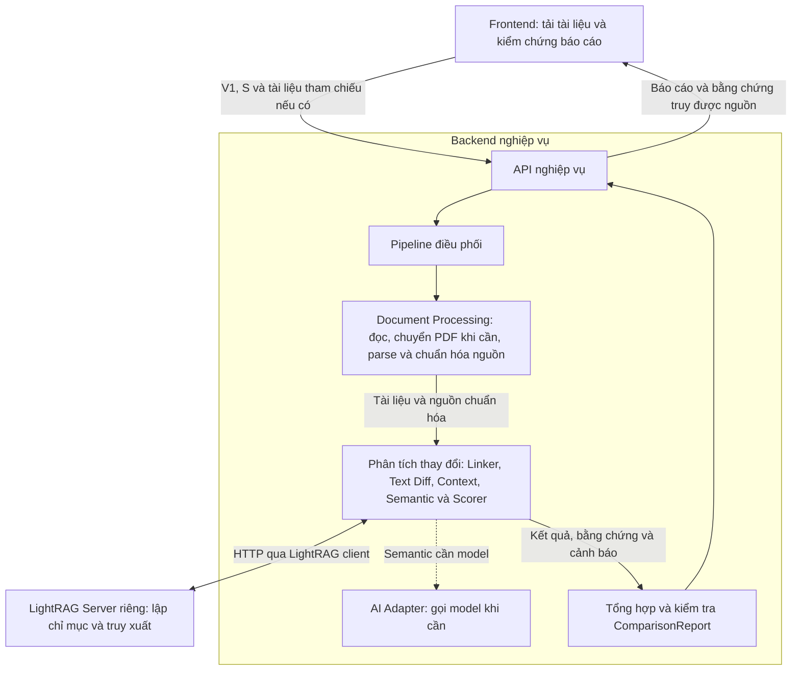
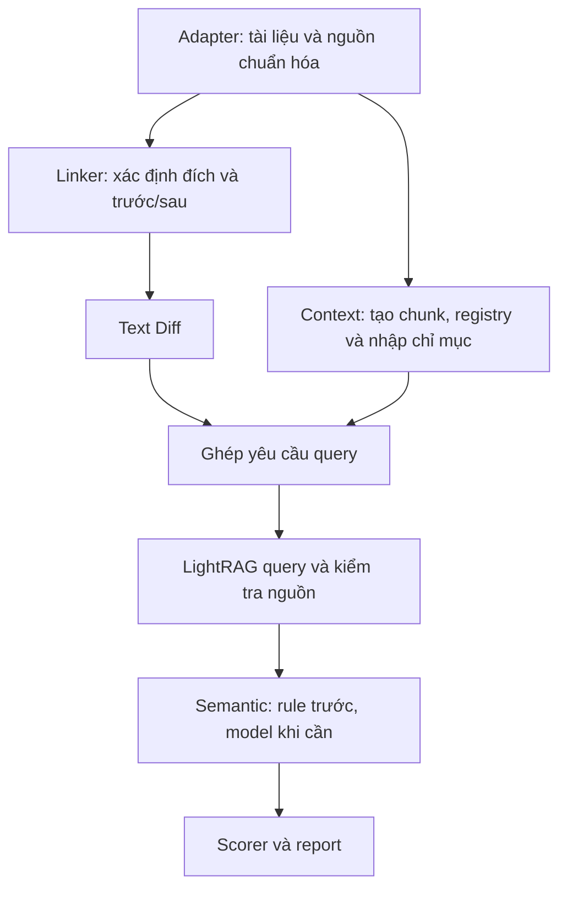

# Architecture — Kiến trúc hệ thống

**Học phần và nhóm:** Problems of Computer Science (POCS) — Nhóm 4
**Dự án:** Hệ thống hỗ trợ đối chiếu thay đổi văn bản pháp luật với AI có giải thích và có sự kiểm chứng của người dùng
**Nhóm trưởng:** Dương Đức Anh
**Thành viên:** Bạch Công Dũng, Dương Đức Anh, Bùi Quang Thọ, Đoàn Ngọc Anh, Đỗ Tuấn Anh
**Phiên bản:** 1.4.0
**Tài liệu liên quan:** [BRD](brd.md), [SRS](srs.md), User Research (tài liệu dự kiến, chưa có), [Implementation Plan](implementation-plan.md), [Module](module.md), [Workflow](workflow.md)

Tài liệu xác định kiến trúc mục tiêu và phân công triển khai. Hiện trạng mã nguồn dưới đây là thông tin đã được ghi nhận, chưa phải kết quả nghiệm thu repository đang sử dụng. Schema và fixture trong mã nguồn cần được đồng bộ với hợp đồng mục tiêu trước khi tích hợp; tài liệu không xác nhận các thay đổi mã nguồn đã hoàn thành.

Hợp đồng chung đã chốt theo schema Đức Anh tại commit b6a13f98b9a7357b9fbb0936aba6bda065d03fcb: ComparisonReport có base_document/amendment_document/reference_documents/results, mỗi result là AmendmentResult. SemanticChange/ChangeAspect và ScoringResult dùng tám nhóm theo report_validation.py. Nhận xét hai loại triển khai sau theo mục 4.2; đợt này không mở rộng schema backend. Xem [SRS mục 1.7](srs.md).

## 1. Lựa chọn kiến trúc và hiện trạng theo main

Hệ thống tập trung vào người dùng sinh viên Luật: hiểu thay đổi, đọc bằng chứng, nhận biết giới hạn và kiểm tra lại sau khi bổ sung tài liệu. Lõi xử lý V1–S cung cấp dữ liệu cho báo cáo, giao diện và đánh giá theo hợp đồng dữ liệu mục tiêu. Chỉ tiêu chất lượng được xác định theo phạm vi và phép đo của hệ thống.

Frontend và backend nghiệp vụ được tách; backend xử lý trong cùng request, frontend giữ file và báo cáo trong phiên; nhận xét phát triển sau. **Đã chốt phương án tích hợp: backend nghiệp vụ gọi LightRAG Server riêng qua HTTP.** Dịch vụ có thể chạy trên cùng máy qua localhost hoặc trên máy riêng được cấu hình; việc chọn phiên bản, endpoint và tham số không thay đổi quyết định tích hợp qua HTTP. Internet chỉ cần theo nơi chạy mô hình/tài nguyên; chưa cam kết offline toàn hệ thống. Phạm vi đầu tiên là retrieval, chưa giao LightRAG sinh báo cáo thay đổi hoàn chỉnh hoặc thay linker/scorer.

| Thành phần | Hiện trạng được ghi nhận | Hướng mục tiêu / việc chờ owner |
| --- | --- | --- |
| PDF → DOCX, Parser | Có implementation xử lý đầu vào | Giữ code trước, thêm adapter nguồn; LK-03 |
| API nền | Route ở backend/main.py; nhận doc_v1/doc_s/reference_files | Chưa chuyển route sang api/compare.py; đổi upload/alias còn chờ LK-11 |
| Pipeline nền | Đọc/parse, envelope cùng tên trường với hợp đồng chung, có điểm nối runner | Schema/validator đã nhập; cần adapter nguồn/Clause và gọi validation trong runner trước trả báo cáo |
| schemas/ | Đã nhập contracts.py và hai validator từ commit căn cứ | Kiểm tra độc lập theo test/schema_suite; chưa nối vào Pipeline |
| Context, change_analysis | Phần lớn là khung trong cấu trúc nền | Owner triển khai theo contract/fixture chung |
| evaluation/ | Giữ thư mục và file hiện có | Không triển khai Evaluator độc lập; kiểm thử do owner tại từng điểm nối phối hợp |
| Frontend | Khung, chưa có ứng dụng chạy hoàn chỉnh | React/TypeScript là định hướng frontend; môi trường và thư viện cụ thể chốt ở yêu cầu frontend trong SRS |
| LightRAG | Cấu trúc main có file client | Release/API/model/index lifecycle theo LK-13 và CN-04 |
| Test | Thư mục khung tên test/ | Giữ tên test/; owner bổ sung kiểm thử, không đổi tests/ riêng trong docs |

Ba file nền main/pipeline/requirements được ghi nhận đã có trong mã nguồn nền, có envelope cùng hình dạng hợp đồng chung nhưng chưa kiểm tra kết quả lồng nhau và thiếu runner phân tích. Đọc/parse hợp lệ hiện báo FAILED/ANALYSIS_NOT_CONFIGURED (HTTP 501). /health chỉ báo API và runner, chưa kiểm tra LightRAG. Chọn công nghệ hoặc có hook không chứng minh đã tích hợp hoặc nghiệm thu.

## 2. Thành phần và ranh giới trách nhiệm

Sơ đồ tổng thể thể hiện đường đi từ tải tài liệu đến hiển thị báo cáo, cùng ranh giới giữa Frontend, backend nghiệp vụ và LightRAG Server. Chi tiết luồng tích hợp sau Document Processing nằm ở mục 4.1.1.



Các module nghiệp vụ gọi nhau bằng hàm/contract; HTTP LightRAG được cô lập trong client. Pipeline không phụ thuộc router hoặc shape response thô của dịch vụ. AI Adapter gọi mô hình và validate kết quả; context client không tự quyết định nhãn pháp lý hay decision người dùng. Log không ghi toàn văn tài liệu, ghi chú hoặc khóa.

| Thành phần | Trách nhiệm | Điểm bàn giao |
| --- | --- | --- |
| Xử lý đầu vào và document_adapter | Chuyển PDF khi cần, parse DOCX; giữ gốc/chuyển đổi, cây, bảng và outside | Dữ liệu nguồn theo document_id/source_ref; contract native/adapter chốt ở LK-03 |
| Amendment linker | Trích chỉ dẫn, văn bản/đích, operation, applicability, trước/sau, hiệu lực | Dữ liệu để phân tích; chưa rõ giữ nguồn/lý do, không tự kết luận thêm/xóa |
| Chunk builder/source registry | Đoạn đủ nghĩa và ánh xạ nguồn | Chunk nội bộ có vai trò/định danh/spans; không coi là payload Server đã chốt |
| LightRAG client | Nhập, theo dõi sẵn sàng, query, lỗi và dọn dữ liệu | Ứng viên retrieval và trạng thái; API cụ thể LK-13 |
| Context builder | Tìm căn cứ theo chỉ dẫn, kiểm tra quote và tài liệu | Ngữ cảnh, ReferenceRequirement, EffectInfo; nguồn vẫn thuộc V1/S/tham chiếu |
| Text Diff | Khác biệt chữ của trước/sau đủ căn cứ | TextChange khớp chuỗi trả frontend |
| Semantic Diff / Scorer / AI Adapter | Nhận định tám nhóm khía cạnh, giải thích, mức tác động; kiểm tra cấu trúc và quote | SemanticDiffResult và list[ScoringResult] đặt trong AmendmentResult, không dùng điểm retrieval làm significance |
| Bộ tổng hợp báo cáo | Giữ cả chỉ dẫn chưa phân tích được, mapping nội bộ và lỗi | ComparisonReport chứa results và định danh/nguồn dùng được |
| Frontend/session | Hiển thị báo cáo, lọc category và bằng chứng; nhận xét hai loại phát triển sau theo mục 4.2 | Phân biệt kết luận ban đầu/cập nhật; nhận xét không tự thành gold |

## 3. Cấu trúc mã nguồn và dữ liệu

Cây thư mục dưới đây lấy từ `main` tại `f76610e`. Các file Python của backend được liệt kê để định vị module. Xem [Module](module.md) để tra trách nhiệm từng file.

```text
.
├── .gitignore
├── README.md
├── backend/
│   ├── app/
│   │   ├── api/
│   │   │   └── compare.py
│   │   ├── change_analysis/
│   │   │   ├── ai_adapter.py
│   │   │   ├── scorer.py
│   │   │   ├── semantic_diff.py
│   │   │   └── text_diff.py
│   │   ├── config.py
│   │   ├── context/
│   │   │   ├── chunk_builder.py
│   │   │   ├── context_builder.py
│   │   │   ├── lightrag_client.py
│   │   │   └── source_registry.py
│   │   ├── document_processing/
│   │   │   ├── amendment_linker.py
│   │   │   ├── document_adapter.py
│   │   │   ├── parser/
│   │   │   │   └── legal_structure_parser.py
│   │   │   └── pdf_to_docx.py
│   │   ├── evaluation/
│   │   │   └── evaluator.py
│   │   ├── pipeline.py
│   │   └── schemas/
│   │       ├── __init__.py
│   │       ├── contracts.py
│   │       ├── report_validation.py
│   │       └── validation.py
│   └── main.py
├── data/
│   ├── raw/
│   │   ├── case_01/
│   │   ├── case_02/
│   │   └── case_03/
│   ├── test_parser/
│   │   └── case_01/
│   └── test_pdf_to_docx/
│       ├── case_01/
│       └── case_02/
├── docs/
├── frontend/
│   ├── public/
│   └── src/
│       ├── assets/
│       ├── components/
│       ├── pages/
│       ├── services/
│       └── styles/
├── requirements.txt
└── test/
    ├── e2e/
    ├── fixtures/
    │   ├── amendments/
    │   ├── documents/
    │   └── reports/
    ├── integration/
    ├── schema_suite/
    └── unit/
        ├── change_analysis/
        ├── context/
        ├── document_processing/
        ├── evaluation/
        └── schemas/
```

Parser hiện tự đọc DOCX, trả dict gồm articles/outside/source_blocks/warnings/status/summary. Node giữ children, segments, full_text, source_refs; không là knowledge graph. Giữ implementation trước, chưa bắt refactor Reader riêng; Thọ chủ trì adapter và mapping nguồn, phối hợp Dũng kiểm tra dữ liệu để các bên nhận dữ liệu tại điểm nối sử dụng được. Reference không có Điều nhưng có blocks/bảng vẫn có thể làm căn cứ; native Parser status không thay ComparisonReport.status.

Source_ref hiện là block:N. Offset segment tính theo ký tự Python [start,end) trên text block; node_id không là khóa ghép phiên bản. Với PDF chuyển đổi, chỉ nói đúng nguồn DOCX đã có; mapping trang PDF là đầu ra cần kiểm chứng, không suy từ số block. LK-04 và yêu cầu hiển thị nguồn trong SRS phải xử lý chuyển chỉ số khi frontend dùng quy ước khác.

Chunk nội bộ dự kiến có comparison_id, document_id, role, unit_path, node_ids, text, source_spans và ID nhóm quản lý. Owner quyết định kích thước/cách ghép ở LK-13; không lấy full_text mọi cấp gây lặp hoặc chỉ node lá làm mất câu dẫn. Không mặc định Server nhận cây dict, giữ metadata hoặc không chia lại chunk. Registry phải nối kết quả query với nguyên văn đã cung cấp.

## 4. Luồng phân tích, dữ liệu và phiên

### 4.1. Một lượt phân tích

Sau adapter, Context chuẩn bị chunk, registry và nhập chỉ mục song song nhánh Linker xác định đích/trước-sau → Text Diff. Điểm ghép chờ index sẵn sàng và TextDiffResult, kết hợp chỉ dẫn, trước/sau và vùng chữ đổi để tạo query. LightRAG truy xuất qua HTTP, registry kiểm tra nguồn/quote rồi mới chuyển sang Semantic. Semantic dùng rule trước, model khi cần; Scorer và Pipeline nhận kết quả cùng bằng chứng/cảnh báo để tổng hợp report.

Owner từng module tự xử lý và báo lỗi thuộc phần mình; chuyển bằng chứng có nguồn cùng lỗi/cảnh báo và phạm vi bị ảnh hưởng cho module nhận đầu ra theo contract chung. Bên nhận kiểm tra dữ liệu, không bỏ cảnh báo hoặc biến thiếu căn cứ thành không có thay đổi. Pipeline tổng hợp trạng thái báo cáo, không thay owner xử lý lỗi nội bộ.

API giữ doc_v1/doc_s/reference_files; Pipeline cấp comparison_id, đọc/parse/adapter, thực hiện luồng chi tiết ở mục 4.1.1 rồi validate report. Báo cáo giữ bằng chứng đã đối chiếu và chỉ dẫn chưa phân tích được. Index phục vụ nhiều chỉ dẫn cùng comparison; cách ly/cleanup thật còn cần kiểm chứng.

#### 4.1.1. Luồng mục tiêu sau Document Processing khi tích hợp LightRAG

Phần này bắt đầu từ đầu ra của Adapter. Chuẩn bị Context và chỉ mục chạy song song với nhánh Linker → Text Diff. Kết quả Text Diff tham gia tạo truy vấn sau khi cả hai nhánh sẵn sàng. Nguồn truy xuất được kiểm chứng trước khi Semantic nhận dữ liệu.



### 4.2. Bổ sung tài liệu và nhận xét

Gửi lại V1/S cùng tham chiếu trong request mới; lượt thất bại giữ báo cáo cũ.

Nhận xét của người dùng thuộc phạm vi mở rộng. Xem [SRS](srs.md#9-phạm-vi-mở-rộng) để tra phạm vi.

### 4.3. Vị trí lưu và vòng đời

Khi đọc V1, S và tài liệu tham chiếu, Adapter gắn định danh và vị trí nguồn cho các đoạn. Các module truyền bằng chứng bằng `EvidenceRef` gồm `document_id`, `source_refs` và `quote`. Pipeline đối chiếu với kho nguồn trước khi trả báo cáo và dọn file tạm. Frontend dùng dữ liệu đã trả để hiện đoạn trích và vị trí khi người dùng chọn **Hiện bằng chứng** trong lượt đang mở. Việc mở thêm đoạn nguồn hoặc lưu bằng chứng qua lượt khác cần quyết định riêng về nơi giữ và quyền đọc.

| Dữ liệu | Nơi giữ | Vòng đời |
| --- | --- | --- |
| File đã chọn, report/nguồn | Frontend | Trong phiên; chưa bảo đảm sau đóng/tải lại tab; cảnh báo trước đổi phiên |
| Nhận xét hai loại (giai đoạn sau) | Chưa chốt nơi lưu | Nhận xét sau phiên cần được lưu; cơ chế và vòng đời chốt khi triển khai |
| File gốc/chuyển đổi dùng xử lý | Vùng tệp tạm của backend | Theo comparison; dọn khi không còn tác vụ dùng, kể cả lỗi |
| Chỉ mục và cache chứa nội dung | LightRAG/storage đã cấu hình | Cách ly và dọn theo comparison phải kiểm chứng; Server chạy liên tục không có nghĩa dữ liệu được giữ lâu dài |
| Nhãn/gold và dữ liệu nghiên cứu | Bộ dữ liệu được quản lý riêng | Không nhập nhãn, V2 đối chiếu hoặc dữ liệu người dùng vào index ngoài chủ định |
| Log | Backend/dịch vụ | ID, bước, lỗi, thời gian; giới hạn lưu chờ LK-12/LK-13; không toàn văn/ghi chú/khóa |

Không xóa vùng dùng chung của Server để giả lập xóa một comparison. HTTP timeout không tự hủy converter/tác vụ phía dịch vụ. Cần xử lý dữ liệu sót hoặc tác vụ tiếp tục chạy; retry có giới hạn, không tự gửi lặp toàn POST từ frontend.

## 5. API, lỗi và contract

API main hiện tại: POST /api/compare, multipart doc_v1/doc_s/reference_files, trả ComparisonReport theo envelope chung. Đề xuất đổi tên upload chưa được chốt bởi quyết định chọn schema. Chưa có API lưu nhận xét/job. Mã HTTP/error body, kích thước, cơ chế nguồn và alias nếu muốn hỗ trợ do LK-11/LK-03 chốt trong api-contract.md (chưa có). Không ghi URL/payload LightRAG chưa kiểm chứng như API chính thức của dự án.

Code nền vẫn dùng doc_v1/doc_s; envelope base_document/amendment_document/reference_documents/results đã cùng hình dạng schema chung. PR #2 đã nhập schema/validator trên main, không thay runner hoặc router; thiếu runner vẫn trả 501/ANALYSIS_NOT_CONFIGURED. SUCCESS/PARTIAL/FAILED, needs_review và nhận xét frontend là các tầng khác nhau.

Với lỗi từng bước, giữ chỉ dẫn/căn cứ đã có và chỉ PARTIAL khi có kết quả dùng được; không có thì FAILED. Lỗi retrieval không tạo REFERENCE_MISSING chỉ vì query rỗng. Có file nhưng chưa tìm đúng đoạn là UNRESOLVED. Không đủ căn cứ phân nhóm thì giữ nguồn, category/field_group null cùng review flags theo contract; không ép nhãn hoặc false/LOW.

## 6. Chủ trì và lựa chọn còn mở

| Owner | Trách nhiệm chính | Quyết định liên quan |
| --- | --- | --- |
| Bạch Công Dũng | Dữ liệu, docs, nghiệp vụ; Pipeline, tích hợp và API; cùng Đức Anh và Ngọc Anh phụ trách Semantic Diff và Scorer; cùng Đức Anh phụ trách AI Adapter và gọi/tích hợp LightRAG | LK-01, LK-02, LK-11, LK-12, CN-04, CN-08, LK-13 |
| Dương Đức Anh | Schema và context; cùng Dũng và Ngọc Anh phụ trách Semantic Diff và Scorer; cùng Dũng phụ trách AI Adapter và gọi/tích hợp LightRAG; điều phối kế hoạch đánh giá | LK-01, LK-03, LK-04, LK-06, CN-03, CN-04, CN-08, LK-13 |
| Bùi Quang Thọ | Chuyển đổi, Parser, document_adapter; trích/liên kết chỉ dẫn và hiệu lực | CN-01, CN-02, LK-03, LK-04, LK-05 |
| Đỗ Tuấn Anh | Frontend/session, hiển thị báo cáo và xử lý lỗi, cảnh báo, trạng thái trả về | LK-01, LK-11, LK-12 |
| Đoàn Ngọc Anh | Text Diff và kiểm thử chéo các điểm nối liên quan; cùng Dũng và Đức Anh phụ trách Semantic Diff và Scorer | CN-05, CN-06, CN-07, LK-01, LK-05, LK-07 |
| Người gọi/tích hợp LightRAG | Dũng + Đức Anh | CN-04, LK-13 |

Phân công chức năng theo LK-01 trong [decision.md](decision.md). Không mặc định một người sở hữu toàn folder change_analysis khi các chức năng được giao cho nhiều người. Đổi thuật toán nội bộ theo phạm vi owner; đổi contract phải được bên giao/nhận review và cập nhật schema/fixture. Quy trình làm việc, Git và kiểm thử theo [workflow.md](workflow.md); không tạo hệ thống mã quyết định D-xx song song.

Không triển khai thêm database lịch sử, account, cộng tác, job/queue hoặc học lại từ nhận xét ở đợt này. Không triển khai module Evaluator độc lập. Các owner bên giao và bên nhận cùng kiểm thử hợp đồng, review cách sử dụng dữ liệu và thử tích hợp; Dũng điều phối tích hợp/Pipeline/API; Đức Anh điều phối kế hoạch đánh giá; các owner thực hiện và kiểm tra chéo; Dũng hỗ trợ dữ liệu/nhãn và kiểm tra nghiệp vụ; Dũng chủ trì nghiên cứu khả năng sử dụng; không lấy chất lượng mô hình làm bằng chứng giao diện hiệu quả hoặc ngược lại. React/TypeScript là định hướng frontend, yêu cầu frontend trong SRS xác nhận môi trường và thư viện; giới hạn, mô hình và ngân sách chưa là cam kết.

### Các quyết định triển khai cần hoàn thiện

Phương án LightRAG Server qua HTTP đã được chốt. Các việc sau là chi tiết hiện thực và kiểm chứng trong phương án này:

- Cố định release và xác nhận API nhập tài liệu, trạng thái sẵn sàng, truy vấn, cách ly và xóa dữ liệu; chưa ghi endpoint hoặc payload chưa kiểm chứng thành contract.
- Chọn LLM/embedding, cấu hình storage, thông tin kết nối, timeout/retry và ngân sách tài nguyên.
- Chốt chunking, source registry và fixture ánh xạ quote về đúng nguồn; kiểm chứng dữ liệu không lẫn giữa các comparison.
- Dùng ComparisonReport/results và tám nhóm theo schema chung; hoàn thiện adapter nguồn/Clause, wiring validator và fixture API; dữ liệu nhận xét frontend và multipart upload chốt riêng. Kiểm thử SUCCESS/PARTIAL/FAILED.
- Áp dụng phân công chức năng đã chốt ở LK-01: Ngọc Anh làm Text Diff; Dũng + Đức Anh + Ngọc Anh phụ trách Semantic Diff và Scorer; Tuấn Anh phụ trách UI và xử lý lỗi trả về; Dũng làm tích hợp/API; Dũng + Đức Anh làm AI Adapter. Đã chốt Dũng + Đức Anh gọi/tích hợp LightRAG; Đức Anh phụ trách context và điều phối kế hoạch đánh giá; còn hoàn thiện chi tiết triển khai và kiểm chứng. Không tự gán owner toàn folder change_analysis.
- Triển khai bán song song: thống nhất contract, schema và fixture trước; bên nhận phát triển với mock/fixture trong khi bên giao hoàn thiện; tích hợp từng điểm nối, không đợi cả chuỗi xong. Chi tiết theo [Workflow](workflow.md) và [Workflow](workflow.md).

### Phát triển theo hợp đồng và hiện trạng schema

Schema chung tại backend/app/schemas đã merge qua PR #2 vào main (`a8a906a`), được nhập nguyên bản từ commit căn cứ của Đức Anh. Không thay Pipeline/API bằng implementation nhánh đó. Pipeline hiện tại trả envelope cùng tên trường nhưng chưa gọi các validator; chưa được coi đã tích hợp chỉ vì có code schema.

Các kiểu AmendmentItem, SemanticChange, ChangeAspect, SemanticDiffResult, TextDiffResult, ScoringResult và AmendmentResult là hợp đồng bàn giao. Tám field_group và category theo validator; không yêu cầu thêm danh mục phân loại bốn nhóm hoặc chuyển báo cáo phẳng. Tham khảo [SRS mục 1.7](srs.md) về kho nguồn, danh sách Clause, các kiểm tra có/không có và công việc nối tiếp.

LK-13 vẫn chốt chi tiết sau các quyết định còn lại. Dũng + Đức Anh gọi/tích hợp LightRAG; Đức Anh phụ trách context và điều phối kế hoạch đánh giá. Việc chọn hợp đồng chung không xác nhận API LightRAG hoặc thuật toán module đã hoàn thành.
