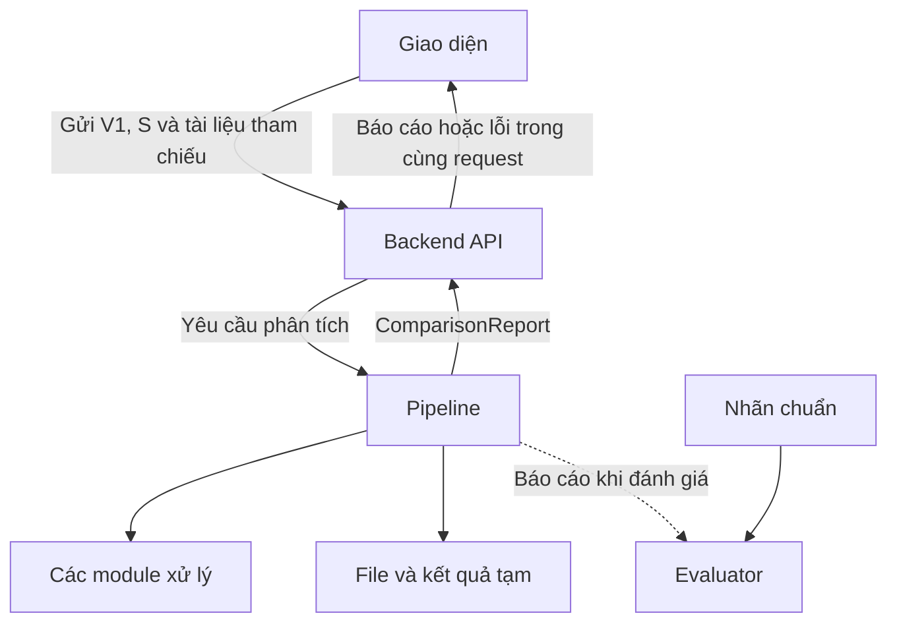
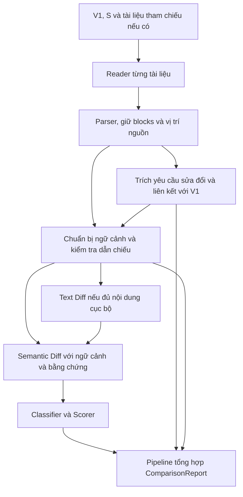

# SOFTWARE ARCHITECTURE

**Project:** Project 7 — Legal Document Change Detection
**Document Version:** 1.3.0
**Last Updated:** 14/10/2026
**Author:** Bạch Công Dũng
**Project Leader:** Dương Đức Anh
**Related Document:** [Software Requirements Specification](srs.md)

Tài liệu này mô tả cách tổ chức các thành phần, luồng xử lý,
trách nhiệm module và các lựa chọn triển khai của hệ thống.

Phạm vi, yêu cầu chức năng, tiêu chí nghiệm thu và hợp đồng dữ liệu
chi tiết được quy định trong SRS. Architecture sử dụng cùng tên
module và cấu trúc dữ liệu với SRS 1.3.0; SRS là nguồn định nghĩa
chi tiết cho hợp đồng, Architecture mô tả trách nhiệm và cách sử dụng.

Bản đầu sử dụng request đồng bộ. API AI bên ngoài và RAG
không thuộc kiến trúc tối thiểu; chỉ bổ sung sau khi nhóm
xác nhận nhu cầu và phương án triển khai.

---

## 1. VẤN ĐỀ VÀ MỤC TIÊU DỰ ÁN (PROBLEM & OBJECTIVES)

### 1.1. Thực trạng & Vấn đề (Problem Statement)
Khi nhận văn bản sửa đổi (S), người đọc phải xác định từng yêu cầu sửa đổi, bổ sung hoặc bãi bỏ và liên kết với đúng nội dung của văn bản ban đầu (V1). Việc giải thích thay đổi cần thông tin tổng quát, ngữ cảnh liên quan và tài liệu được dẫn chiếu khi cần. Quá trình này tốn nhiều thời gian và rất dễ bỏ sót các thay đổi quan trọng (ví dụ: thay đổi thời hạn thanh toán từ 30 ngày thành 15 ngày, hoặc tăng mức phạt vi phạm, thay đổi ngữ nghĩa các cụm từ(tối thiểu,tối đa,....) ).

### 1.2. Mục tiêu hệ thống (Project Objectives)
* Trích yêu cầu sửa đổi trong S và xác định nội dung bị tác động trong V1, đến Điều/Khoản/Điểm hoặc cụm từ được chỉ định.
* Phân biệt **thay đổi văn phong/diễn đạt** và **thay đổi ngữ nghĩa pháp lý** khi có đủ căn cứ; thể hiện rõ kết quả chưa xác định và nhu cầu kiểm tra.
* Tự động đánh giá mức độ quan trọng và gán nhãn rủi ro cho các biến đổi pháp lý.

### 1.3. Đối tượng sử dụng (Target Users)
* Nhóm ưu tiên: luật sư và người làm pháp chế cần rà soát thay đổi quy định.
* Nhóm bổ sung: sinh viên luật và người nghiên cứu cần đối chiếu, giải thích thay đổi bằng bằng chứng.
* Nhu cầu và tình huống sử dụng chi tiết theo BRD; kết quả hỗ trợ người dùng kiểm chứng với văn bản nguồn.

---

### 2. PHẠM VI VÀ GIỚI HẠN

### 2.1. Trong phạm vi

- Hai tài liệu chính: văn bản ban đầu V1 và văn bản sửa đổi S có nội dung tác động đến V1; S không phải bản đầy đủ sau sửa đổi V2.
- DOCX là định dạng chính; hỗ trợ PDF có lớp chữ. Tài liệu tham chiếu do người dùng cung cấp ngay từ đầu hoặc bổ sung theo yêu cầu.
- Reader đọc từng tài liệu; Parser nhận diện Điều, giữ cấu trúc Khoản/Điểm và nội dung bảng cùng vị trí nguồn.
- Trích từng yêu cầu sửa đổi, bổ sung, bãi bỏ trong S; phân biệt văn bản đích và liên kết đến đúng Điều/Khoản/Điểm hoặc cụm từ của V1. S có thể sửa nhiều văn bản; chỉ phân tích tác động đến V1 được chọn và ghi rõ phần thuộc văn bản khác.
- Phân tích phần thay đổi với thông tin tổng quát của V1 và ngữ cảnh liên quan như định nghĩa, điều kiện, ngoại lệ; không bắt buộc phân tích từng đoạn không thay đổi hoặc dựng toàn bộ V2.
- Text Diff đối chiếu nội dung trước/sau cục bộ khi đủ căn cứ; Semantic Diff phân tích nghĩa, Classifier & Scorer phân loại và đánh giá mức tác động theo tiêu chí chung.
- Trích thông tin hiệu lực và chuyển tiếp trong S, giữ phạm vi áp dụng, ngoại lệ và bằng chứng; không tự xác minh hiệu lực thực tế.
- Nhận diện nội dung dẫn chiếu cần thiết; thông báo tài liệu còn thiếu. Người dùng có thể bổ sung để phân tích lại; nếu thiếu thì giữ kết quả đã xác định và giới hạn nhận định bị ảnh hưởng.
- Kết quả giữ bằng chứng và vị trí nguồn trong đúng V1, S hoặc tài liệu tham chiếu.

### 2.2. Ngoài phạm vi của bản đầu

- OCR và PDF scan dạng ảnh.
- Tạo bản V2 đầy đủ hoặc tự động tổng hợp nhiều văn bản sửa đổi thành bản hợp nhất.
- Tự động giải quyết đầy đủ mọi chỉ dẫn tách/gộp hoặc yêu cầu có vị trí đích chưa xác định được.
- So sánh toàn diện phần mở đầu, chữ ký và phụ lục. Nội dung đọc được ở các phần này, bao gồm bảng được dẫn chiếu, vẫn có thể làm ngữ cảnh hoặc bằng chứng.
- Tự thu thập, cập nhật hoặc duy trì kho văn bản pháp luật dùng chung; tự xác minh tính chính thức và hiệu lực pháp lý thực tế.
- Tư vấn pháp lý tự động, hợp đồng và văn bản ngoài phạm vi VBQPPL tiếng Việt đã chọn.

Reader giữ toàn bộ nội dung có thể đọc được, bao gồm bảng và phần ngoài Điều, để phục vụ truy nguồn và lấy ngữ cảnh. Không diff toàn bộ V1 với S và không xem phần V1 không được nhắc đến là bị xóa. Báo cáo chỉ rõ phạm vi đã xử lý và phần còn thiếu.

---

## 3. SƠ ĐỒ KIẾN TRÚC TỔNG THỂ (SYSTEM ARCHITECTURE)

### 3.1. Kiến trúc logic



Pipeline điều phối các module và tổng hợp báo cáo.
Evaluator chạy riêng khi kiểm thử, không nằm trong luồng
so sánh thông thường của người dùng.

Các module thuộc cùng một backend và gọi nhau qua hàm Python.
Backend chờ Pipeline hoàn tất rồi trả kết quả trong cùng HTTP request.
Bản đầu không sử dụng Queue/Worker; chính sách vận hành nằm ở mục 7.

### 3.2. Luồng xử lý nghiệp vụ



Pipeline giữ từng AmendmentItem, kết quả Text Diff nếu có, Semantic Diff, Scoring, thông tin hiệu lực/chuyển tiếp, nhu cầu tài liệu tham chiếu, cảnh báo và lỗi. Trích hiệu lực/chuyển tiếp thuộc bước xử lý S và gắn vào EffectInfo theo bằng chứng.

Reader và Parser chạy riêng cho từng tài liệu. Bước trích yêu cầu tạo AmendmentItem; bước ngữ cảnh bổ sung AnalysisContext và kiểm tra nội dung dẫn chiếu trong những file người dùng đã cung cấp. Nếu thiếu, tạo ReferenceRequirement với trạng thái MISSING hoặc UNRESOLVED; không tự tải tài liệu.

Text Diff xử lý before_text/after_text của từng AmendmentItem khi đủ căn cứ. Nội dung sau có thể được trích từ S hoặc suy ra cục bộ từ chỉ dẫn rõ ràng; phải giữ after_basis, không gán nội dung suy ra thành trích dẫn nguyên văn. Nếu chưa xác định một phía, không chạy Text Diff nhưng vẫn giữ chỉ dẫn sửa đổi và phân tích được phần có căn cứ.

Semantic Diff tạo SemanticChange và aspects theo SRS mục 1.3, sử dụng ngữ cảnh V1 và tài liệu tham chiếu có nguồn. Classifier & Scorer chọn category tổng thể và chấm mức độ của SemanticChange; không tạo lại aspects hoặc chấm riêng từng khía cạnh. Pipeline giữ cảnh báo đến báo cáo; không bắt buộc tạo V2 đầy đủ.

### 3.3 Ranh giới module và cấu trúc thư mục
*Lưu ý: các đường dẫn dưới đây là đề xuất tổ chức mã nguồn, cần đối chiếu
với repo trước khi chốt. Đây không phải xác nhận các file đã tồn tại.*
```text
backend/main.py                    # Đức Anh: nhận yêu cầu, trả báo cáo
src/schemas.py                     # Đức Anh: hiện thực hợp đồng theo SRS
src/pipeline.py                    # Đức Anh: điều phối, tổng hợp báo cáo

src/reader/document_reader.py      # Thọ: đọc DOCX/PDF text
src/parser/doc_parser.py           # Thọ: tách các Điều
src/amendment/amendment_linker.py  # Thọ: trích chỉ dẫn, liên kết V1, trích hiệu lực
src/context/context_builder.py    # Chuẩn bị ngữ cảnh, kiểm tra tài liệu tham chiếu

src/text_diff/diff_engine.py       # Ngọc Anh: tìm thay đổi chữ
src/semantic_diff/diff_engine.py   # Ngọc Anh: xác định thay đổi nghĩa
src/classifier_scorer/scorer.py    # Ngọc Anh: phân loại, chấm tác động

src/evaluation/evaluator.py        # Tuấn Anh: đánh giá với nhãn chuẩn
frontend/                         # Tuấn Anh: giao diện demo tối thiểu

tests/fixtures/                   # Dữ liệu mẫu theo hợp đồng chung
data/raw/                         # Dũng: tài liệu nguồn
data/T1/T1-001/                   # Dũng: mẫu V1–S và references/ khi cần
data/manifest.csv                 # Dũng: metadata, nguồn và thông tin tuyển chọn
data/gold/                        # Tuấn Anh điều phối nhãn chuẩn
docs/                             # Tài liệu chung và tài liệu module
```

Reader chịu trách nhiệm đọc file và ghi vị trí nguồn.
Parser nhận ExtractedDocument, xác định ranh giới các Điều, giữ Khoản/Điểm; không tự đọc lại file. Blocks ngoài Điều và bảng vẫn được giữ để bước ngữ cảnh truy xuất. Tài liệu tham chiếu không có nhãn Điều có thể được truy xuất theo blocks; không loại bỏ chỉ vì không tách được Điều.

Bước trích yêu cầu/liên kết và bước ngữ cảnh dùng các hợp đồng SRS mục 1.2. context_builder là ranh giới trách nhiệm đề xuất; người phụ trách cụ thể được thống nhất khi phân công triển khai, không tạo một hợp đồng dữ liệu riêng.

Pipeline tổng hợp ComparisonReport từ kết quả các module.
Các module xử lý không tự gọi giao diện hoặc phụ thuộc HTTP.
Backend quản lý vòng đời request và file tạm; Pipeline điều phối nghiệp vụ.

Adapter gọi API AI bên ngoài và các thành phần Queue/Worker chỉ được bổ sung
khi nhóm xác nhận phương án triển khai.
### 3.4. Giao tiếp giữa các module

Tên hàm dưới đây là đề xuất triển khai. Kiểu dữ liệu và quy tắc
đầu vào/đầu ra tuân theo SRS mục 1 và mục 2.

| Thành phần | Hàm đề xuất | Đầu vào | Đầu ra |
| --- | --- | --- | --- |
| Reader | read_document | File, document_id và role | ExtractedDocument |
| Parser | parse_document | ExtractedDocument | list[Clause]; blocks gốc được giữ để truy xuất |
| Trích yêu cầu/liên kết | extract_and_link_amendments | V1 và S đã đọc/tách cấu trúc | list[AmendmentItem] với chỉ dẫn, vị trí đích và EffectInfo |
| Ngữ cảnh/dẫn chiếu | prepare_context | AmendmentItem và các tài liệu đã cung cấp | AmendmentItem được bổ sung AnalysisContext và ReferenceRequirement |
| Text Diff | compute_text_diff | AmendmentItem đủ nội dung trước/sau cục bộ | TextDiffResult |
| Semantic Diff | detect_semantic_changes | AmendmentItem có context và TextDiffResult nếu có | SemanticDiffResult với SemanticChange.aspects |
| Classifier & Scorer | classify_and_score | AmendmentItem và SemanticDiffResult | list[ScoringResult] |
| Pipeline | run_comparison | V1, S, tài liệu tham chiếu nếu có, comparison_id và metadata do Backend cung cấp | ComparisonReport với base_document/amendment_document/reference_documents |
| Evaluator | evaluate | Báo cáo dự đoán và nhãn chuẩn | Các chỉ số và kết quả đối chiếu |

Mỗi module phải có thể kiểm thử riêng bằng dữ liệu mẫu đúng
hợp đồng. Khi module phía trước chưa hoàn thành, dùng fixture
hoặc mock tương ứng để tiếp tục phát triển.

Không duy trì một bộ hợp đồng khác với SRS. Nếu cần thay đổi,
nhóm phải cập nhật hợp đồng, schema và dữ liệu mẫu cùng nhau.


### 3.5. Quy ước dữ liệu dùng chung

Định nghĩa chi tiết nằm trong SRS mục 1. Architecture chỉ tóm tắt
các quy ước cần thiết để hiểu luồng xử lý.

- Clause đại diện một Điều, gồm:
  unit_id, id, title, content và source_refs.
- AmendmentItem định danh từng yêu cầu bằng amendment_id; giữ operation, instruction, target_document, target_locator, target_unit_ids, applicability, before_text/after_text, after_basis, evidence, effect_info, context và cảnh báo theo SRS mục 1.2.
- operation nhận AMEND, ADD, REPEAL hoặc UNRESOLVED. applicability nhận APPLIES, OTHER_DOCUMENT hoặc UNRESOLVED; yêu cầu sửa văn bản khác không được áp vào V1.
- Liên kết mơ hồ dùng needs_review = true và lý do; một Điều V1 có thể được nhiều yêu cầu tham chiếu.
- AnalysisContext giữ thông tin tổng quát, bằng chứng ngữ cảnh và ReferenceRequirement; EffectInfo giữ nội dung hiệu lực/chuyển tiếp và phạm vi áp dụng.
- Một AmendmentItem có thể sinh nhiều SemanticChange; mỗi SemanticChange
  có danh sách ChangeAspect mô tả các khía cạnh của cùng thay đổi quy định.
- ChangeAspect gồm aspect_id, field_group, old_value, new_value,
  interpretation, evidence, old_quote, new_quote, needs_review và review_reason.
  aspect_id duy nhất trong SemanticChange; truy vết bằng change_id + aspect_id.
- field_group dùng 8 nhóm trong SRS mục 1.3:
  SUBJECT_OBJECT; RIGHTS_DUTIES_ACTIONS; CONDITIONS_EXCEPTIONS;
  TIME_QUANTITY; PROCEDURE_AUTHORITY; CONSEQUENCES_SANCTIONS;
  DEFINITIONS_REFERENCES; SCOPE_EFFECT_TRANSITION.
  Tên tiếng Việt, định nghĩa và ranh giới phân nhóm theo SRS.
- Chỉ ghi khía cạnh thay đổi hoặc cần xác minh; giữ nội dung không đổi
  làm ngữ cảnh. Không nhân bản một biến đổi vào nhiều nhóm.
  Bằng chứng ở cả cấp thay đổi và khía cạnh phải có EvidenceRef, xác định đúng document_id và source_refs của V1, S hoặc tài liệu tham chiếu.
- is_meaningful_change nhận true, false hoặc null.
  null biểu thị chưa đủ căn cứ và phải có cảnh báo kiểm tra.
- Mỗi SemanticChange có một ScoringResult tương ứng.
- category là nhãn tổng thể: một field_group đã xác định trong aspects
  theo quy tắc ưu tiên, WORDING_ONLY khi chỉ đổi diễn đạt, hoặc null
  khi chưa chọn được nhãn. WORDING_ONLY không phải nhóm ChangeAspect thứ chín.
- Nhãn tổng thể không thay thế các khía cạnh; reason giải thích lựa chọn
  category và mức độ của toàn bộ SemanticChange. Không cộng điểm theo số khía cạnh.
- significance nhận LOW, MEDIUM, HIGH, CRITICAL hoặc null.
- Chỉ đổi diễn đạt: significance = LOW.
- Chưa xác định có đổi nghĩa:
  significance = null và is_critical = null.
- comparison_id định danh lần so sánh;
  amendment_id định danh yêu cầu sửa đổi;
  change_id định danh từng thay đổi.
- ComparisonReport.status nhận SUCCESS, PARTIAL hoặc FAILED.
- None/null và danh sách rỗng được hiểu theo từng trường trong SRS.
  TextDiffResult.changes rỗng chỉ nói hai chuỗi cục bộ không khác nhau; không phủ nhận chỉ dẫn sửa đổi hoặc thay đổi hiệu lực;
  không thay kết quả chưa xử lý bằng danh sách rỗng.
- aspects = [] dùng khi chỉ đổi diễn đạt hoặc chưa xác định được khía cạnh;
  phải đọc cùng is_meaningful_change và needs_review, không tự suy ra không đổi nghĩa.
  Đổi nghĩa đã xác định phải có ít nhất một khía cạnh đổi nghĩa có căn cứ.
- old_value/new_value hoặc quote bằng null phải được interpretation
  giải thích là không có nội dung tương ứng hay chưa xác định được;
  trường hợp chưa xác định phải có cảnh báo theo SRS. Riêng nội dung sau được suy ra có thể có new_quote = null nhưng phải giữ bằng chứng và giải thích phép suy ra; không tự coi là thiếu căn cứ nếu chỉ dẫn đã rõ.
- Cảnh báo từ ChangeAspect được tổng hợp lên SemanticChange,
  SemanticDiffResult, ScoringResult và giữ đến báo cáo/giao diện.
  Cảnh báo chưa được giải quyết không được trình bày như kết luận chắc chắn.
- ComparisonReport có base_document, amendment_document và reference_documents theo DocumentIdentity, gồm document_id, role và filename; V1 là BASE, S là AMENDMENT, các tài liệu bổ sung là REFERENCE.
  Backend ghi nhận metadata từ đầu vào; Pipeline giữ trong mọi báo cáo,
  kể cả PARTIAL/FAILED. Tên file không xác nhận tên pháp lý hoặc hiệu lực.
- Thiếu căn cứ tham chiếu cần cho phân tích tác động: báo PARTIAL, giữ thay đổi trực tiếp đã xác định và chỉ rõ nhu cầu bổ sung. Không biến nội dung chưa biết thành chuỗi rỗng để diff.
- Chỉ thông báo không tìm thấy yêu cầu sửa đổi đối với V1 khi thỏa điều kiện SRS mục 1.7; không suy từ Text Diff rỗng.
- Cảnh báo phải được giữ xuyên suốt đến báo cáo và giao diện.

comparison_id chỉ định danh lần so sánh, không phải mã job để truy vấn sau.
ComparisonReport.status mô tả mức hoàn tất của báo cáo, không phải mã HTTP.
Bản đầu không cung cấp trạng thái job hoặc API polling.

### 3.6. Ví dụ AmendmentItem

Ví dụ tự tạo để minh họa hợp đồng, không phải văn bản pháp luật thật. Các trích dẫn và source_refs phải khớp ExtractedDocument của đúng document_id khi dùng làm fixture chạy được. Giả định ví dụ đã cung cấp đủ ngữ cảnh và không có ngoại lệ liên quan.

```json
{
  "amendment_id": "amendment_1",
  "operation": "AMEND",
  "instruction": {
    "document_id": "s",
    "source_refs": [
      "docx:paragraph_3"
    ],
    "quote": "Thay cụm từ ‘30 ngày’ bằng cụm từ ‘15 ngày’ tại khoản 1 Điều 5 của Văn bản A."
  },
  "target_document": "Văn bản A",
  "target_locator": "khoản 1 Điều 5",
  "target_unit_ids": [
    "v1:article_5"
  ],
  "applicability": "APPLIES",
  "before_text": "Hồ sơ phải được nộp trong thời hạn 30 ngày.",
  "after_text": "Hồ sơ phải được nộp trong thời hạn 15 ngày.",
  "after_basis": "DERIVED",
  "evidence": [
    {
      "document_id": "v1",
      "source_refs": [
        "docx:paragraph_13"
      ],
      "quote": "1. Hồ sơ phải được nộp trong thời hạn 30 ngày."
    },
    {
      "document_id": "s",
      "source_refs": [
        "docx:paragraph_3"
      ],
      "quote": "Thay cụm từ ‘30 ngày’ bằng cụm từ ‘15 ngày’ tại khoản 1 Điều 5 của Văn bản A."
    }
  ],
  "effect_info": [
    {
      "text": "Văn bản này có hiệu lực từ ngày 01 tháng 01 năm 2030.",
      "applies_to": "Toàn bộ nội dung sửa đổi của S trong ví dụ",
      "evidence": [
        {
          "document_id": "s",
          "source_refs": [
            "docx:paragraph_8"
          ],
          "quote": "Văn bản này có hiệu lực từ ngày 01 tháng 01 năm 2030."
        }
      ],
      "needs_review": false,
      "review_reason": ""
    }
  ],
  "context": {
    "general_context": "Văn bản A quy định việc nộp hồ sơ của tổ chức.",
    "evidence": [
      {
        "document_id": "v1",
        "source_refs": [
          "docx:paragraph_3"
        ],
        "quote": "Văn bản này quy định việc nộp hồ sơ của tổ chức."
      }
    ],
    "references": []
  },
  "needs_review": false,
  "review_reason": ""
}
```

Text Diff xác định “30 ngày” thành “15 ngày” trên hai chuỗi cục bộ. after_basis = DERIVED cho biết câu sau được suy ra từ chỉ dẫn thay cụm từ, không phải trích nguyên văn toàn câu từ S.

Semantic Diff có thể tạo một SemanticChange với ChangeAspect nhóm TIME_QUANTITY, diễn giải rút ngắn thời hạn. old_quote có thể trích “30 ngày” từ V1 và new_quote trích “15 ngày” từ chỉ dẫn trong S; EvidenceRef giữ đúng nguồn. Thông tin hiệu lực nằm trong EffectInfo, không mặc định trở thành một thay đổi riêng nếu chưa có căn cứ đối chiếu. Scorer chấm theo guideline, không mặc định CRITICAL. Ví dụ nhiều khía cạnh xem SRS mục 1.3.

## 4. WORKFLOW VÀ PHÂN CÔNG

### 4.1. Workflow

1. Người dùng chọn văn bản gốc V1, văn bản sửa đổi S và tài liệu tham chiếu nếu có.
2. Backend kiểm tra đầu vào, cấp comparison_id, ghi nhận DocumentIdentity với vai trò từng tài liệu, lưu file tạm và gọi Pipeline trong cùng request.
3. Reader đọc từng file, tạo ExtractedDocument; Parser tách Điều, giữ cấu trúc Khoản/Điểm và blocks để truy xuất ngữ cảnh.
4. Bước trích yêu cầu/liên kết tạo AmendmentItem, nhận diện văn bản đích, định vị nội dung trong V1 và trích thông tin hiệu lực/chuyển tiếp liên quan từ S. Yêu cầu sửa văn bản khác được ghi OTHER_DOCUMENT.
5. Bước ngữ cảnh lấy thông tin tổng quát của V1, đoạn liên quan và tài liệu dẫn chiếu đã cung cấp; ghi rõ nội dung cần bổ sung nếu còn thiếu.
6. Với từng yêu cầu liên quan đến V1:
   - Text Diff chạy khi đủ nội dung trước/sau cục bộ; nội dung suy ra phải được đánh dấu.
   - Semantic Diff phân tích phần thay đổi cùng ngữ cảnh và bằng chứng, tạo SemanticChange và aspects; giữ phần chưa xác định.
   - Classifier & Scorer chọn category và chấm từng SemanticChange, giữ cảnh báo; không chấm riêng từng ChangeAspect.
7. Pipeline tổng hợp ComparisonReport với base_document, amendment_document, reference_documents, từng AmendmentResult, nguồn, hiệu lực, tài liệu thiếu, cảnh báo và lỗi.
8. Backend trả báo cáo trong cùng request, giải phóng tài nguyên và dọn file tạm khi không còn tác vụ sử dụng.
9. Nếu cần tài liệu bổ sung, giao diện hiển thị yêu cầu về tài liệu và vị trí còn thiếu. Người dùng có thể chọn gửi bộ tài liệu tham chiếu đã bổ sung trong request đồng bộ mới; nếu không bổ sung, báo cáo hiện tại vẫn giữ các kết quả đã xác định.

Giao diện hiển thị đúng vai trò tài liệu, chỉ dẫn trong S, vị trí bị tác động trong V1 và từng khía cạnh của thay đổi. Giao diện giữ lựa chọn file trong phiên trang để gửi lại khi người dùng chủ động bổ sung; không yêu cầu lưu trạng thái xử lý hoặc kho tài liệu trên server.

Giao diện chờ phản hồi, hiển thị đang xử lý và ngăn gửi lặp khi request còn chạy. Không hiển thị phần trăm tiến độ giả; không tự gửi lại khi timeout. Mất kết nối không đồng nghĩa Pipeline đã dừng; chính sách thời gian chạy xem mục 7.

Data collection chạy độc lập để tạo dữ liệu phát triển, demo và đánh giá. Evaluator chạy riêng trên báo cáo và nhãn chuẩn của cùng cặp V1–S với bộ tài liệu tham chiếu tương ứng.

### 4.2. Phân công dự kiến

| Thành viên | Trách nhiệm chính |
| --- | --- |
| Bạch Công Dũng | Kiến trúc, tài liệu tổng quát, metadata và tuyển chọn dữ liệu; phối hợp đặc tả hợp đồng và guideline cho 8 nhóm khía cạnh |
| Dương Đức Anh | Nhóm trưởng, Backend, Pipeline, hiện thực schema gồm ChangeAspect/DocumentIdentity, tổng hợp đầy đủ báo cáo và tích hợp |
| Bùi Quang Thọ | Reader, Parser; trích yêu cầu sửa đổi, liên kết với V1 và trích thông tin hiệu lực/chuyển tiếp |
| Đoàn Ngọc Anh | Text Diff, Semantic Diff tạo các khía cạnh; Classifier & Scorer chọn nhãn và chấm mức độ tổng thể |
| Đỗ Tuấn Anh | Evaluator với nhãn chuẩn có khía cạnh, kiểm thử độc lập và giao diện hiển thị các khía cạnh/bằng chứng/cảnh báo |

### 4.3. Quy tắc phối hợp

- SRS là nguồn tham chiếu chính cho hợp đồng dữ liệu hiện tại.
- Dũng và Đức Anh phối hợp cập nhật tài liệu; các chủ module
  review phần đầu vào/đầu ra liên quan trước khi chốt.
- Thay đổi hợp đồng phải được nhóm trưởng phê duyệt, cập nhật
  schema và fixture, đồng thời thông báo các module liên quan.
- Mỗi module có dữ liệu mẫu, cách chạy riêng và kiểm thử riêng.
- Bộ fixture gồm không đổi, đổi diễn đạt, đổi nghĩa, thêm/xóa,
  chỉ dẫn đánh lại số, liên kết mơ hồ, S sửa nhiều văn bản, đủ/thiếu tài liệu tham chiếu và hiệu lực có ngoại lệ; bổ sung ca một thay đổi có nhiều
  khía cạnh, khía cạnh chưa xác định, tránh trùng nhóm và file trùng tên.
- Chủ module cập nhật fixture và test theo SRS 1.3.0. Tuấn Anh điều phối
  nhãn chuẩn có aspects; Dũng phối hợp guideline, các thành viên review
  cách chia/gộp, nhóm trường, nội dung trước/sau và bằng chứng.
- Dữ liệu test có nhãn được giữ riêng với dữ liệu dùng chỉnh thuật toán.
- Bàn giao gồm mã nguồn, input/output mẫu, cách kiểm tra,
  giới hạn đã biết và PR.

---

## 5. YÊU CẦU CHẤT LƯỢNG ẢNH HƯỞNG ĐẾN KIẾN TRÚC

Các mục tiêu trong SRS:

- Change F1 ≥ 0,90.
- Critical Change Recall ≥ 0,95 trên bộ kiểm thử độc lập.

Đây là các ngưỡng SRS đang nêu cho nghiệm thu, chưa phải chất lượng
đã được chứng minh. Nhóm cần xác nhận trước khi dùng làm tiêu chí
nghiệm thu chính thức.

Evaluator tuân theo các nguyên tắc:

- Đối chiếu ở cấp SemanticChange; dự đoán và nhãn chuẩn được ghép
  một-một, không tính mỗi ChangeAspect thành một thay đổi độc lập.
- Nhãn chuẩn có các khía cạnh kỳ vọng; quy tắc matching phải quy định
  cách xử lý thiếu/sai khía cạnh trước đánh giá. Không tính đúng chỉ vì
  trùng field_group; ghi riêng lỗi nhóm, giá trị, diễn giải và bằng chứng.
- Thay đổi chuẩn bị bỏ sót vẫn phải được tính, kể cả khi nguyên nhân
  đến từ Reader, Parser, trích yêu cầu hoặc liên kết.
- Một thay đổi CRITICAL chỉ được tính tìm đúng khi đối chiếu
  đúng thay đổi và dự đoán is_critical = true.
- Kết quả cần kiểm tra chưa được giải quyết không tính là tìm đúng.
- Mẫu số bằng 0 trả null kèm lý do.
- Báo số mẫu và số kết quả cần kiểm tra cùng các chỉ số.
- Kiểm tra riêng liên kết vị trí đích, thông tin hiệu lực và yêu cầu bổ sung tài liệu. Nhãn chuẩn phản ánh đúng tài liệu được cung cấp; mẫu thiếu căn cứ được đánh giá theo khả năng nhận diện giới hạn, không yêu cầu kết luận dựa trên tài liệu ẩn.

Để hỗ trợ đánh giá, các module phải giữ định danh, bằng chứng,
vị trí nguồn và cảnh báo đến ComparisonReport.

Ngoài chỉ số phát hiện, kiểm tra chất lượng diff_details, interpretation,
bằng chứng và lý do chấm theo SRS mục 4. Thử nghiệm khả năng hiểu báo cáo
gồm nhận diện vai trò V1/S/tài liệu tham chiếu, tìm vị trí nguồn, giải thích thay đổi và nhận biết
giới hạn/cảnh báo; ghi độ đúng, thời gian, lỗi diễn giải và phản hồi.
Đây là đánh giá ngoài luồng so sánh, không thêm module phản hồi vào sản phẩm.

Định nghĩa yêu cầu xem SRS. Quy trình tạo nhãn, chia dữ liệu, cách tính,
người tham gia và ngưỡng thử nghiệm được hoàn thiện trong Evaluation Plan;
nếu thành viên nhóm đóng vai người dùng phải ghi rõ giới hạn.

---

### 6. GIẢ ĐỊNH VÀ RỦI RO

### 6.1. Giả định

- Người dùng cung cấp đúng V1 và S, bổ sung tài liệu tham chiếu cần thiết; việc đọc thành công không xác nhận tính chính thức hoặc hiệu lực thực tế.
- File thuộc định dạng hỗ trợ và có nội dung chữ trích xuất được.
- Không giả định tiêu đề Điều được đánh dấu bằng Word Heading.
- Việc sử dụng mô hình hoặc API ngoài cần được nhóm xác nhận.
  Yêu cầu kết nối mạng chỉ áp dụng khi lựa chọn đó được sử dụng.

### 6.2. Rủi ro và phương án xử lý

| Rủi ro | Phương án |
| --- | --- |
| Đọc thiếu hoặc sai thứ tự nội dung | Reader giữ thứ tự và vị trí nguồn; kiểm thử trên file có bảng và nhiều trang |
| Parser nhận nhầm câu dẫn chiếu là đầu Điều | Kiểm tra ranh giới, cấu trúc và các ca dẫn chiếu trong fixture |
| Phụ lục bị gộp vào Điều cuối | Parser phân biệt ranh giới Điều và phụ lục; vẫn giữ blocks phụ lục cho ngữ cảnh khi cần |
| Nhầm số Điều trong S với vị trí đích, hoặc chỉ dẫn tách/gộp mơ hồ | Kiểm tra văn bản đích, Điều/Khoản/Điểm và nội dung; cảnh báo vị trí chưa chắc chắn |
| Thiếu hoặc sai phiên bản tài liệu dẫn chiếu | Kiểm tra nội dung cần đọc; báo ReferenceRequirement còn thiếu/chưa rõ, giữ kết quả trực tiếp và giới hạn phân tích tác động |
| Gán sai hiệu lực chung cho thay đổi có ngoại lệ | Giữ EffectInfo cùng phạm vi và bằng chứng; cảnh báo phần chưa xác định |
| File lớn hoặc tác vụ kéo dài | Giới hạn dung lượng, thời gian, bộ nhớ và mức đồng thời; xử lý theo đơn vị phù hợp |
| Thiếu nhãn chuẩn | Gán nhãn có hướng dẫn, đối soát bất đồng và duy trì tập test độc lập |
| Semantic Diff chưa đủ căn cứ | Trả kết luận chưa xác định và needs_review; không tự coi là không đổi nghĩa |
| Module phân tích hoặc chấm điểm thất bại | Giữ lỗi và phần chưa xử lý trong ComparisonReport; dùng PARTIAL hoặc FAILED phù hợp |
| API ngoài gặp lỗi nếu được sử dụng | Timeout, retry có giới hạn và báo phần chưa hoàn tất |
| Hai module dùng hợp đồng khác nhau | Kiểm tra schema, fixture chung và review thay đổi trước khi tích hợp |

Few-shot, embedding hoặc RAG là các lựa chọn cải thiện thuật toán,
không thay thế dữ liệu nhãn chuẩn để đánh giá.

---
## 7. PHƯƠNG ÁN TRIỂN KHAI VÀ CÁC QUYẾT ĐỊNH CẦN CHỐT

### 7.1. Quyết định triển khai bản đầu

- Dùng request đồng bộ: API nhận V1, S và tài liệu tham chiếu nếu có, gọi Pipeline, chờ kết quả và trả phản hồi trong cùng request.
- Tổ chức một backend chia module; mỗi module có thể kiểm thử độc lập qua hàm và schema chung.
- Không triển khai Redis, Celery, Queue/Worker, API tạo job hoặc polling cho bản đầu.
- Pipeline giữ giao diện run_comparison; không phụ thuộc HTTP, giao diện hoặc hạ tầng hàng đợi.
- Xử lý các yêu cầu sửa đổi tuần tự ở bản đầu để dễ kiểm thử và kiểm soát chi phí; chỉ tăng mức đồng thời sau khi đo và đặt giới hạn.
- Request đồng bộ là cách trả kết quả cho client; không bắt buộc mọi thao tác I/O trong mã nguồn phải blocking. Nếu dùng framework async, không chạy tác vụ blocking/CPU nặng trực tiếp trên event loop.

Lý do: phạm vi demo nhỏ, không OCR, không lưu lịch sử lâu dài; ưu tiên
hoàn thiện và đánh giá luồng so sánh. Đây là quyết định về độ đơn giản
triển khai, không phải khẳng định Pipeline luôn chạy nhanh.

### 7.2. API và giao diện

API upload dự kiến: POST /api/compare, nhận multipart/form-data
với hai file chính doc_v1 và doc_s, cùng danh sách reference_files nếu có; trả ComparisonReport trong cùng request. Tên trường là đề xuất, cần chốt trong API contract. Cấu trúc phản hồi, mã HTTP và lỗi được quy định trong
docs/api-contract.md.

Đây là giao diện mục tiêu; API baseline hiện tại vẫn nhận
hai chuỗi text và chưa hỗ trợ upload file.

- Báo cáo theo SRS 1.3.0 giữ base_document/amendment_document/reference_documents, AmendmentItem và SemanticChange.aspects; API không làm phẳng hoặc bỏ khía cạnh khi trả JSON.
- Giao diện lấy tên file từ metadata báo cáo, luôn kèm vai trò văn bản gốc V1 / văn bản sửa đổi S / tài liệu tham chiếu, kể cả khi hai tên file giống nhau.
- Trong từng thay đổi, hiển thị giải thích tổng thể, category và mức độ; từng khía cạnh có tên nhóm tiếng Việt, nội dung cũ/mới, interpretation, bằng chứng và cảnh báo. Không dùng nhãn tổng thể thay cho danh sách khía cạnh.
- Vị trí nguồn lấy từ EvidenceRef của đúng document_id, hiển thị nhãn trang PDF hoặc đoạn/bảng DOCX theo SRS mục 4. Phân biệt nguồn chỉ dẫn trong S và vị trí đích V1; không khẳng định tọa độ chính xác từng quote khi chỉ có vị trí cấp Điều.
- Nội dung có nhiều vị trí nguồn phải hiển thị đủ; bổ sung/bãi bỏ vẫn giữ chỉ dẫn trong S, nội dung trước/sau không tồn tại được phân biệt với chưa xác định. Người dùng tự đối chiếu file gốc; bản đầu không bắt buộc nhúng trình xem hoặc mở chính xác vị trí bằng một lần nhấn.
- Không chỉ dùng màu để phân biệt loại thay đổi, mức độ hoặc cảnh báo; trường chưa xác định được hiển thị rõ cùng lý do, không suy ra không đổi từ aspects rỗng.
- comparison_id dùng liên kết log và báo cáo; không có cam kết truy vấn lại kết quả bằng mã này.
- Backend phân biệt lỗi kiểm tra đầu vào, lỗi toàn bộ lần so sánh và lỗi riêng từng yêu cầu sửa đổi.
- Nếu một số yêu cầu lỗi nhưng vẫn tổng hợp được báo cáo, giữ bằng chứng, cảnh báo và phần chưa xử lý; dùng PARTIAL theo SRS.
- Hiển thị EffectInfo cùng phạm vi áp dụng; ReferenceRequirement chỉ rõ tài liệu và vị trí còn thiếu. Người dùng có thể bổ sung rồi chủ động gửi lại toàn bộ bộ file, tạo lần xử lý mới; server không lưu file chờ bổ sung.
- Đổi dẫn chiếu A → B cần căn cứ cả A và B nếu chưa có trong đầu vào để kết luận tác động trước–sau; nếu thiếu, chỉ báo thay đổi trực tiếp và giới hạn.
- Không biến lỗi Semantic Diff thành kết luận không có thay đổi hoặc danh sách rỗng giả.
- API contract quy định rõ ánh xạ HTTP status, error body và ComparisonReport.status; không dùng ba trường hợp SUCCESS/PARTIAL/FAILED làm mã HTTP.
- Giao diện có trạng thái chờ, báo cáo và lỗi; ngăn gửi lặp khi đang chờ. Không tự retry toàn bộ POST.
- Không cung cấp chức năng hủy tác vụ hoặc tiếp tục xem job sau khi tải lại trang trong bản đầu.

### 7.3. Giới hạn, timeout và xử lý lỗi

Trước khi tích hợp API thật, nhóm phải chốt giới hạn dung lượng mỗi file,
số tài liệu tham chiếu, số yêu cầu sửa đổi/nội dung được xử lý, số request so sánh đồng thời và ngân sách
thời gian xử lý. Ghi giá trị, đơn vị và môi trường đo trong SRS và
docs/development-guide.md; architecture không tự đặt ngưỡng chưa đo.

- Kiểm tra dung lượng/định dạng sớm; sau Reader/Parser kiểm tra giới hạn nội dung và khả năng trích xuất.
- Khi đủ số tác vụ cho phép, từ chối yêu cầu mới bằng lỗi được đặc tả; không tạo hàng đợi nền ngầm không giới hạn.
- Đặt timeout cho từng lần gọi API ngoài và deadline cho toàn bộ Pipeline. Retry lỗi tạm thời có giới hạn, nằm trong deadline còn lại.
- Kiểm tra deadline giữa các bước/yêu cầu sửa đổi; timeout của HTTP hoặc việc đóng trang không tự dừng mã đang chạy.
- Tác vụ thư viện không hỗ trợ ngắt cần được giới hạn đầu vào hoặc cô lập nếu phải bảo đảm dừng cứng; không tuyên bố có hard timeout khi chỉ dừng chờ phản hồi.
- Cấu hình thời gian chờ của client/server/proxy theo ngân sách xử lý, có thời gian dự phòng để trả lỗi và dọn tài nguyên.
- Khi hết ngân sách, chỉ trả PARTIAL nếu đã tạo được báo cáo hợp lệ theo SRS; nếu không, trả lỗi/FAILED theo API contract. Không để request chờ vô hạn.
- Đo thời gian Reader, Parser, trích yêu cầu/liên kết, chuẩn bị ngữ cảnh, Text Diff, Semantic Diff, Scorer và tổng Pipeline; ghi số tài liệu/yêu cầu cần phân tích và số lần gọi mô hình.

### 7.4. Quản lý file và kết quả

- Mỗi lần so sánh dùng thư mục tạm riêng gắn comparison_id; không dùng nguyên tên file do client cung cấp làm đường dẫn lưu.
- File tạm chỉ xóa sau khi các tác vụ sử dụng file đã kết thúc, kể cả khi request mất kết nối hoặc có retry API ngoài.
- Dọn tài nguyên trong cơ chế finally hoặc tương đương; bổ sung dọn file sót do tiến trình dừng bất thường, bảo đảm không xóa file đang được dùng.
- Báo cáo trả trực tiếp trong response; bản đầu không yêu cầu database, kho pháp luật dùng chung hay lưu lịch sử lâu dài. File tham chiếu tuân theo cùng vòng đời file tạm; không giữ file sau xử lý để chờ người dùng bổ sung.
- Nếu kết quả được ghi ra file tạm để tạo response, giữ file đến khi gửi xong rồi dọn.
- Không ghi toàn bộ nội dung tài liệu vào log; log định danh, thời gian, bước xử lý và lỗi cần thiết.

### 7.5. Các quyết định còn cần chốt

- Công nghệ backend/frontend và phiên bản môi trường chạy.
- Phương pháp Semantic Diff, embedding/LLM nếu có; vai trò cụ thể và cách gọi mô hình.
- API AI có bắt buộc không; đặc tả và quyền truy cập. RAG chỉ bổ sung khi có nhu cầu đã xác định.
- Giới hạn đầu vào, số request đồng thời, timeout/retry và môi trường đo hiệu năng.
- Ví dụ ranh giới 8 nhóm field_group, quy tắc chia/gộp SemanticChange và chọn category tổng thể từ aspects; danh mục mã theo SRS 1.3.0.
- Quy tắc severity, nhãn chuẩn có khía cạnh, matching và tiêu chí đánh giá diễn giải/khả năng hiểu báo cáo.
- Tên trường API, mã HTTP, error body, dữ liệu mẫu và cách xử lý PARTIAL/FAILED.

DOCX là đầu vào chính, PDF có lớp chữ là đầu vào hỗ trợ. Công cụ đọc trực tiếp hoặc chuyển đổi PDF trong Reader được lựa chọn khi triển khai; phải giữ khả năng truy nguồn và hợp đồng ExtractedDocument. Công nghệ cụ thể của từng module được thống nhất khi họp hoặc giao người phụ trách lựa chọn trong ràng buộc SRS và hợp đồng chung.

### 7.6. Điều kiện xem xét lại quyết định

Đo trên các cặp tài liệu đại diện: ngắn/dài, ít/nhiều thay đổi, có bảng,
chỉ dẫn đánh lại số, liên kết mơ hồ, đủ/thiếu tài liệu tham chiếu. Nếu thời gian thường vượt ngân sách
chờ, không ổn định do mô hình/API ngoài, hoặc phát sinh yêu cầu theo dõi
tiến độ và lấy kết quả sau khi tải lại trang, nhóm xem xét job bất đồng bộ.

Khi thay đổi, giữ hợp đồng nghiệp vụ của Pipeline; bổ sung hợp đồng job,
Queue/Worker, nơi lưu trạng thái/kết quả và vòng đời file. Cập nhật SRS,
architecture và API contract cùng nhau. Đây là hướng mở rộng, không
thuộc các thành phần phải xây dựng cho bản đầu.