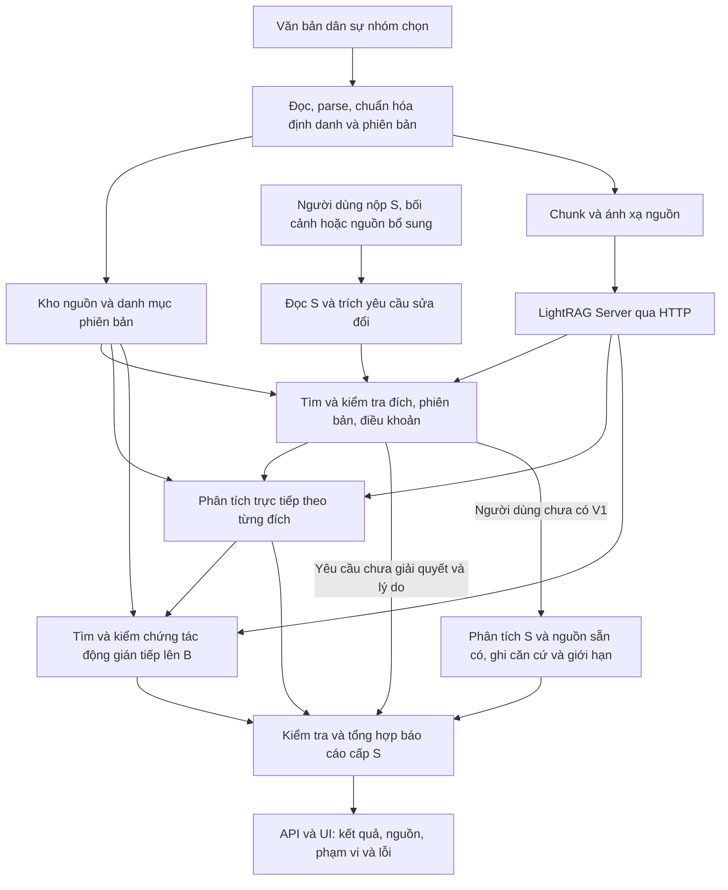
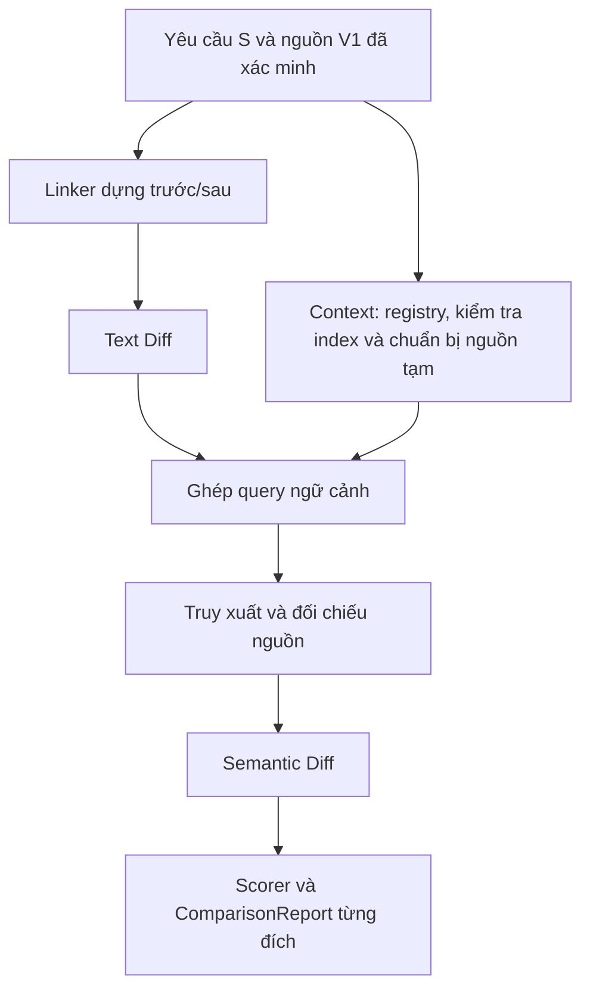

# Architecture — Kiến trúc hệ thống

**Dự án:** Legal Document Change Detection — POCS, Nhóm 4

**Phiên bản:** 1.6.0 — đồng bộ nghiệp vụ ngày 20/11/2026

**Căn cứ:** [BRD](brd.md), [SRS](srs.md), [ghi chú buổi học 17/11](https://docs.google.com/document/d/1MzAXePwcTFb18FKzVs5J4jh8rc9Qz1CwCf1u7wW2Mrw/edit), quyết định Đức Anh xác nhận ngày 20/11 trong [Decision](decision.md).

## 1. Lựa chọn kiến trúc và hiện trạng theo main

### Bài toán và phạm vi mục tiêu

Người dùng nộp một văn bản sửa đổi S và có thể thêm bối cảnh hoặc nguồn bổ sung. Hệ thống tự tìm văn bản, phiên bản trước sửa đổi V1 và quy định bị tác động trong kho dân sự nhóm chuẩn bị. Với từng đích, hệ thống giải thích thay đổi trực tiếp; sau đó tìm và kiểm chứng các quy định B có thể chịu tác động gián tiếp. S không phải bản đầy đủ V2. Không bắt buộc hợp nhất toàn văn.

Một S có thể sửa nhiều văn bản. Kết quả gồm từng đích, trước/sau, ý nghĩa và mức độ khi đủ căn cứ, tác động gián tiếp, bằng chứng và phần chưa xử lý. Không tự mở rộng tìm Internet. Đích ngoài kho, thiếu phiên bản hoặc nhiều ứng viên phải được giữ cùng lý do, không tự lấy bản mới nhất. Việc chọn phiên bản dựa vào định danh, căn cứ thời điểm và nguồn; thuật toán giải quyết trường hợp lịch sử phức tạp còn phải kiểm chứng.

B liên quan đến V1 chưa chứng minh B bị ảnh hưởng. Phải chỉ ra quy định B sử dụng phần nào của V1 và phần thay đổi làm cách hiểu hoặc áp dụng B khác đi thế nào. Không tự kết luận B bị sửa hoặc hết hiệu lực. Không tìm thấy ứng viên cũng không chứng minh không có tác động ngoài phạm vi đã rà soát.

### Code đã có và phần chưa triển khai

Mốc code đối chiếu là main sau PR #7, commit `95e1d79f42e682fba361ecf36fc45321f52a2d9d`. BRD/SRS của PR #9 tại `e745237` được kế thừa trong lần cập nhật tài liệu này. Không lấy code trên nhánh thử nghiệm riêng làm khả năng của main.

| Thành phần | Đã có trong nền chung | Khoảng cách tới nghiệp vụ mục tiêu |
| --- | --- | --- |
| Reader/Parser/Adapter | Parser DOCX, nguồn block, cây và adapter; PR #6 có kiểm thử hồi quy | PDF xuyên luồng và nguồn/phiên bản trong kho dân sự cần kiểm chứng |
| Linker | Quy tắc hẹp nhận V1/S đã chuẩn hóa, dựng một số cặp trước/sau | Trích yêu cầu độc lập với V1, nhiều đích và thao tác mở rộng chưa hoàn chỉnh |
| Text Diff | Kết quả theo amendment_id, offset ký tự Python | Kiểm thử trên các loại sửa đổi mở rộng |
| Context | PR #7 tách index/query; query nhận TextDiffResult sau điểm chờ | Demo tắt retrieval; chưa có truy xuất đích hoặc tác động gián tiếp |
| LightRAG client | HTTP client thử nghiệm, pin upstream và kiểm thử mô phỏng | Chưa nghiệm thu dịch vụ thật; client hiện dành một server/storage riêng cho một comparison, chưa dùng được như kho bền vững dùng chung |
| Semantic/Scorer | Quy tắc giới hạn, giữ null/review khi thiếu căn cứ | LLM, rubric dân sự và kiểm chứng tác động gián tiếp chưa hoàn thành |
| API/UI | Demo DOCX nhận V1 + S + tham chiếu, trả ComparisonReport | Đầu vào chỉ S và báo cáo cấp S ở SRS §1.8 chưa có API/schema/validator thực thi |
| Kho và điều phối cấp S | Chưa triển khai trong nền chung | Danh mục dân sự, phiên bản kho, xác định đích và tổng hợp nhiều báo cáo |

[Nền chung](common-baseline.md) giữ lệnh chạy và bằng chứng. Tài liệu này mô tả đích triển khai, không xác nhận hệ thống mới đã chạy.

## 2. Thành phần và ranh giới trách nhiệm

Tách hai luồng: chuẩn bị kho trước lượt phân tích và xử lý S của người dùng. Kho nguồn là nơi tra cứu nguyên văn và phiên bản; LightRAG là chỉ mục truy xuất ứng viên, không thay kho nguồn hoặc quyết định pháp lý.

| Chức năng | Đầu vào → đầu ra và ranh giới |
| --- | --- |
| Chuẩn bị kho | Tệp và nguồn nhóm chọn → tài liệu/phiên bản, cấu trúc, nguyên văn, snapshot kho và chỉ mục có ánh xạ. Không nhập nhãn đáp án vào retrieval |
| Trích chỉ dẫn | S đã parse → yêu cầu có ID, thao tác, dấu hiệu đích và nguồn S; không cần V1 đã tồn tại |
| Xác định đích | Yêu cầu + danh mục/nguồn → đích và phiên bản có căn cứ, hoặc ứng viên/lý do chưa giải quyết |
| Linker/dựng trước–sau | Yêu cầu + nguồn V1 đã xác minh → AmendmentItem cục bộ. Giữ QUOTED/DERIVED/ABSENT/UNRESOLVED |
| Context/Text Diff | Nguồn và AmendmentItem → khác biệt chữ, ngữ cảnh có bằng chứng và lỗi theo PR #7 |
| Semantic/Scorer/AI Adapter | Trước/sau, diff và ngữ cảnh → nhận định/ngưỡng theo hợp đồng cục bộ, hoặc null/review |
| Tác động gián tiếp | Thay đổi trực tiếp + kho → quy định B, liên kết về thay đổi gốc, giải thích và bằng chứng hoặc lý do cần kiểm tra |
| Điều phối/API/UI | Yêu cầu chưa giải quyết + kết quả từng đích + tác động → báo cáo cấp S, phạm vi và lỗi |

Backend Python gọi các module bằng hàm/dữ liệu có cấu trúc. LightRAG Server riêng được gọi qua HTTP. AI Adapter quản lý gọi model và kiểm tra đầu ra. Chưa bắt buộc kiến trúc đa agent; lớp điều phối có thể là workflow xác định thứ tự. Model, thuật toán và công nghệ lưu trữ chưa được chọn thay nhóm trong tài liệu này.

## 3. Cấu trúc mã nguồn và dữ liệu

Giữ cấu trúc repo, không tạo folder/file khung mới chỉ để khớp sơ đồ. [Module](module.md) định vị file và điểm bàn giao; tên file cho chức năng mới chỉ chốt khi có contract/triển khai được review.

| Đường dẫn hiện có | Vai trò |
| --- | --- |
| `backend/app/document_processing/` | Parser, document_adapter, amendment_linker và chuyển đổi PDF |
| `backend/app/context/` | chunk_builder, source_registry, lightrag_client, context_builder, semantic_bridge |
| `backend/app/change_analysis/` | text_diff, semantic_diff, scorer, ai_adapter |
| `backend/app/schemas/` | contracts và validator của báo cáo từng V1 |
| `backend/app/pipeline.py`, `backend/main.py` | Pipeline/API nền; route chưa tách hoàn toàn sang api/compare.py |
| `backend/demo.py`, `backend/app/demo_runner.py` | Điểm chạy demo DOCX và wiring phân tích giới hạn |
| `frontend/` | UI demo và phần frontend đang phát triển |
| `data/`, `test/`, `deploy/lightrag/` | Nguồn/fixture, kiểm thử và cấu hình thử nghiệm; dữ liệu hiện có chưa tự trở thành kho dân sự đã duyệt |

Parser hiện tự đọc DOCX, trả articles/outside/source_blocks và trạng thái; không bắt refactor Reader riêng để triển khai nghiệp vụ mới. Cây Parser không phải knowledge graph. Chunk phải giữ câu dẫn/ngữ cảnh cần thiết và có thể tra về nguyên văn; không lặp full_text mọi cấp hoặc chỉ lấy node lá làm mất nghĩa.

Các fixture 9 điểm nối hiện có chỉ mô tả lõi một V1; không phải hợp đồng cho truy xuất đích, nhiều phiên bản hoặc tác động gián tiếp. Lõi này tiếp tục được dùng để kiểm thử hồi quy.

## 4. Luồng phân tích, dữ liệu và phiên

### 4.1. Một lượt phân tích

1. Ghi nhận S, nguồn bổ sung và snapshot kho được dùng. Kiểm tra định dạng, đọc, parse và phạm vi dân sự có căn cứ. Đích ngoài phạm vi được ghi riêng; tiếp tục phần dân sự đủ căn cứ. Thiếu trong kho được chuyển nhánh bổ sung nguồn.
2. Trích yêu cầu từ S độc lập với việc đã tìm thấy V1. Giữ nguồn và dấu hiệu văn bản/Điều/Khoản/Điểm cho từng yêu cầu.
3. Tra cứu chính xác số hiệu và metadata trước; dùng retrieval tìm ứng viên khi cần. Đối chiếu nguồn, phiên bản, vị trí và căn cứ thời điểm. Khi thiếu V1, yêu cầu bổ sung theo SRS UI-01. Người dùng chưa có tài liệu thì phân tích chỉ dẫn S và nguồn hợp lệ sẵn có, giữ kết luận có căn cứ cùng giới hạn và yêu cầu chưa giải quyết. Phân biệt nhiều văn bản đích với nhiều phiên bản ứng viên của một văn bản.
4. Với từng đích có đủ căn cứ, tạo binding nguồn cục bộ rồi dùng Linker dựng trước/sau. Chưa rõ nội dung thì không tạo chuỗi giả để chạy Text Diff.
5. Chạy Text Diff và chuẩn bị ngữ cảnh theo mục 4.1.1; Semantic/Scorer giữ bằng chứng và trạng thái cần kiểm tra.
6. Từ phần V1 thực sự thay đổi, tìm B có thể phụ thuộc vào nó. Lấy nguyên văn B và kiểm chứng tác động theo mục 4.1.2.
7. Kiểm tra từng ComparisonReport và mapping cấp S; tổng hợp kết quả, tác động, yêu cầu chưa giải quyết và phạm vi rà soát. Một đích lỗi không làm mất kết quả hữu ích của đích khác.

#### 4.1.1. Luồng mục tiêu sau Document Processing khi tích hợp LightRAG

LightRAG có ba mục đích riêng. Query tìm đích chỉ cần yêu cầu từ S; query ngữ cảnh dùng trước/sau và TextDiffResult khi đã có; query tìm B dùng quy định bị sửa và kết quả thay đổi trực tiếp. Không bắt mọi query chờ Text Diff, không dùng hàm query của PR #7 thay cả ba bước.

Trong lõi phân tích từng đích, chuẩn bị nguồn/index tạm có thể chạy song song Linker → Text Diff. Chỉ mục kho đã chuẩn bị không phải nhập lại cho mỗi item. Truy vấn ngữ cảnh phải chờ dữ liệu cần thiết và chỉ mục tương ứng sẵn sàng; đối chiếu nguồn trước Semantic.

**Đã có:** PR #7 chuẩn bị index song song Text Diff, chờ cả hai rồi ghép query; kiểm tra amendment_id, offset và nội dung. **Chưa có:** chuẩn bị index song song cả Linker ở Pipeline, binding kho bền vững và dịch vụ thật. Demo dùng client=None. Kết quả HTTP mô phỏng không là bằng chứng LightRAG thật hoạt động.

#### 4.1.2. Kiểm chứng tác động gián tiếp

Tìm ứng viên B bằng dẫn chiếu, quan hệ hoặc tìm kiếm ngữ nghĩa trong snapshot kho. Với từng ứng viên, xác định đúng văn bản/phiên bản và điều khoản, đọc nguồn, chỉ ra B sử dụng phần nào của V1 rồi so với thay đổi trước/sau. Quan hệ có căn cứ trực tiếp và quan hệ suy ra phải được phân biệt trong giải thích; không coi cạnh KG là quan hệ pháp lý đã được xác nhận.

Một nhận định giữ đích, amendment_id/change_id khi có, nguồn V1 và B, nguồn trung gian nếu dùng, giải thích và tình trạng đủ/thiếu căn cứ. Có quan hệ nhưng phần bị sửa không ảnh hưởng B thì không báo thành tác động đã xác nhận. Chưa đủ căn cứ thì giữ ứng viên cần kiểm tra. Ngưỡng tìm kiếm, độ sâu quan hệ và cách biểu diễn trạng thái cụ thể còn cần đặc tả, không tự bổ sung enum vào schema cũ.

### 4.2. Bổ sung tài liệu và nhận xét

Thiếu nguồn thì chỉ rõ văn bản/phiên bản/quy định cần bổ sung. UI cho bổ sung hoặc chọn “Hiện tại không có tài liệu”. Với lựa chọn thứ hai, backend tiếp tục dùng S và nguồn sẵn có để tạo kết luận có căn cứ và đánh dấu phần trước/sau hoặc tác động chưa xác định. Giữ kết quả đích khác. V1 bổ sung được kiểm tra quan hệ với S; nếu sai, trả dấu hiệu và yêu cầu thay file theo SRS UI-02.

Bổ sung nguồn tạo lượt phân tích mới trong cùng trải nghiệm UI. UI giữ báo cáo trước trong lúc chờ và khi lượt mới lỗi. Đếm riêng văn bản đích, yêu cầu và điều khoản đủ/thiếu nguồn. Nguồn người dùng được quản lý theo lượt, chỉ nhập vào kho chung qua quy trình quản lý kho. Nhận xét và lịch sử thuộc phạm vi mở rộng ở SRS §9.

Giao diện trình bày chuỗi căn cứ chọn V1 → trước/sau → nhận định → liên hệ B khi có → kết luận và giới hạn, chỉ rõ mắt xích thiếu nguồn. Một nguồn có thể vừa cung cấp ngữ cảnh vừa là đối tượng kiểm tra tác động. UI hiển thị đúng vai trò ứng với từng nhận định.

### 4.3. Vị trí lưu và vòng đời

| Dữ liệu | Phạm vi và vòng đời mục tiêu |
| --- | --- |
| Kho dân sự và bản gốc | Lưu qua nhiều lượt, có định danh/phiên bản và snapshot; cập nhật theo quy trình quản lý kho |
| Chỉ mục LightRAG của kho | Gắn với snapshot/cấu hình lập chỉ mục; chỉ sẵn sàng khi mapping và trạng thái nhập được kiểm tra; không xóa khi kết thúc một comparison |
| S, nguồn bổ sung và index tạm | Theo analysis_id; cách ly lượt chạy, dọn đúng tài nguyên tạm sau xử lý kể cả lỗi; không xóa kho chung |
| Nguồn cục bộ từng đích | comparison_id thuộc analysis_id, ánh xạ về phiên bản thật; không trộn ID v1/s giữa các báo cáo |
| Báo cáo và bằng chứng đã trả | UI giữ quote, định danh và chuỗi căn cứ trong phiên để mở nhiều lần sau cleanup. “Kết thúc phiên” xóa báo cáo, trạng thái và lựa chọn trên UI. Mở rộng API đọc nguồn sau lượt cần chốt riêng |
| Gold/nhãn và log | Gold giữ ngoài retrieval; log không chứa toàn văn hoặc khóa, thời hạn lưu cần chốt |

Giữ document identity, version identity và snapshot riêng. Trong mỗi ComparisonReport cục bộ, tiếp tục dùng v1/BASE, s/AMENDMENT và ref_*/REFERENCE theo validator. Lớp cấp S ánh xạ (target_id, document_id cục bộ) về phiên bản nguồn thật; không dùng filename hoặc số Điều làm khóa toàn kho.

EvidenceRef giữ document_id, toàn bộ source_refs và quote nguyên văn. Registry phải đối chiếu đúng bản nguồn, không chỉ đúng đoạn chữ ở tài liệu khác. block:N là nguồn block, không phải số trang PDF; offset Text Diff là ký tự Python [start,end). Mapping trang PDF và chuyển chỉ số sang frontend phải kiểm chứng.

Client thử nghiệm hiện dành server/storage riêng cho một comparison và có reservation/cleanup tương ứng. Không nối client này thẳng vào kho dùng chung hoặc bỏ kiểm tra cách ly để chạy được. Cần adapter/cấu hình vòng đời được review và kiểm thử trước khi dùng kho bền vững. Timeout HTTP không tự hủy tác vụ; retry nhập/xóa phải tránh trùng hoặc xóa nhầm.

## 5. API, lỗi và contract

**API đang chạy:** POST /api/compare nhận doc_v1, doc_s, reference_files; backend.demo:app trả ComparisonReport theo schema hiện có. backend.main:app chưa gắn runner, trả 501/ANALYSIS_NOT_CONFIGURED sau đầu vào hợp lệ. Không sửa route/schema/code trong đợt tài liệu này.

**API mục tiêu:** S bắt buộc, bối cảnh/nguồn bổ sung tùy chọn, báo cáo cấp S theo SRS §1.8 gồm analysis_id, snapshot/coverage, targets, unresolved_amendments, indirect_impacts và trạng thái/lỗi. Tên endpoint, multipart, kiểu dữ liệu đầy đủ, mapping ID và validator cấp S cần được bên API/schema/UI review trước code. Chưa có api-contract.md, không dẫn file đó như hợp đồng thực thi.

Giữ ComparisonReport/AmendmentResult, tám nhóm field_group và quy tắc null/review trong từng đích. Hợp đồng cấp S là lớp bao mới, không thêm khóa vào payload cũ để lách validator. Kiểm tra report cục bộ không thay kiểm tra liên kết nhiều đích hoặc bằng chứng gián tiếp.

Lỗi retrieval không đồng nghĩa thiếu tài liệu hoặc không có thay đổi. Danh sách rỗng chỉ có nghĩa sau bước đã chạy trong phạm vi công bố. Báo cáo cấp S dùng SUCCESS khi hoàn thành các bước bắt buộc trong phạm vi công bố, PARTIAL khi có kết quả hữu ích nhưng còn phần chưa xử lý/cần kiểm tra, FAILED khi không có kết quả hữu ích; giữ yêu cầu và lý do kể cả FAILED. Mapping HTTP mới và định nghĩa kết quả hữu ích cấp S phải cụ thể hóa cùng fixture. Không thay nghĩa trạng thái của validator cục bộ bằng mô tả tổng quát này.

Request đồng bộ tiếp tục là phương án dự kiến; phải đo trên nhiều đích và tác động gián tiếp trước nghiệm thu. Chưa chốt chuyển sang job/queue/polling hoặc đa agent chỉ vì mở rộng phạm vi.

Thử lại theo E4 được người dùng yêu cầu chủ động. Điều phối kiểm tra dữ liệu trung gian còn lưu, nguồn/phiên bản và cấu hình cần thiết trước khi tiếp tục bước lỗi. Nếu dữ liệu đã cleanup hoặc không còn hợp lệ, tạo lượt mới với S và các nguồn cần thiết. Thông báo phần chạy lại, giữ báo cáo cũ và kiểm soát tác vụ còn chạy để tránh gửi trùng. Cơ chế lưu/tái dùng dữ liệu cần được đặc tả trước triển khai. E6 hủy trước kết quả tiếp tục là đề xuất theo SRS §4.2.

Trạng thái SUCCESS ghi nhận hoàn thành xử lý trong phạm vi công bố; độ đúng của kết luận được đánh giá riêng trong nghiệm thu. Hoàn tất Use Case yêu cầu kết quả có bằng chứng xem được và thể hiện giới hạn. Nhận xét của người dùng là chức năng mở rộng.

## 6. Chủ trì và lựa chọn còn mở

Giữ phân công chức năng ở [LK-01](decision.md#lk-01--phân-công-theo-modulechức-năng): Dũng dữ liệu/docs và Pipeline/API; Thọ xử lý tài liệu/Linker; Ngọc Anh Text Diff; Đức Anh schema/context; Dũng + Đức Anh + Ngọc Anh Semantic/Scorer; Dũng + Đức Anh AI Adapter/LightRAG; Tuấn Anh UI. Không tự giao toàn bộ chức năng mới cho một người bằng sơ đồ kiến trúc. Task/owner mới và reviewer từng điểm nối được thống nhất theo Workflow, không tạo bảng giao việc theo tuần trong docs.

Các mục còn mở có thể nghiên cứu song song nhưng phải chốt điểm nối trước khi triển khai phần phụ thuộc:

- Danh mục kho dân sự, nguồn tin cậy, phiên bản và quy trình cập nhật; chưa có bộ kho dân sự đã nghiệm thu chỉ vì có data/raw.
- Dữ liệu đầy đủ cho yêu cầu trích từ S, ứng viên đích, mapping phiên bản, bằng chứng và trạng thái tác động gián tiếp; schema/validator cấp S và fixture mới.
- Công nghệ lưu nguồn, cấu hình LightRAG bền vững/cách ly nguồn tạm, model/embedding, chunking, timeout/retry và ngân sách.
- Phương pháp tìm quan hệ không có dẫn chiếu, kiểm chứng tác động, rubric dân sự và bộ gold độc lập.
- Hợp đồng API/UI, giới hạn request và kết quả đo để xác nhận phương án đồng bộ.

Nghiệm thu cần ca chỉ S, nhiều đích, sai/thiếu phiên bản, ngoài kho, B có tác động, B liên quan nhưng không chịu tác động, thiếu căn cứ, retrieval lỗi và cleanup không xóa kho. Đo riêng truy xuất đích/phiên bản, thay đổi trực tiếp, tác động gián tiếp và đầu cuối; lỗi chọn V1 phải tính vào lỗi đầu cuối. Không tự đặt ngưỡng chính thức hoặc báo mock là tích hợp thật. Xem [kế hoạch đánh giá](test_evaluation_plan.md).
