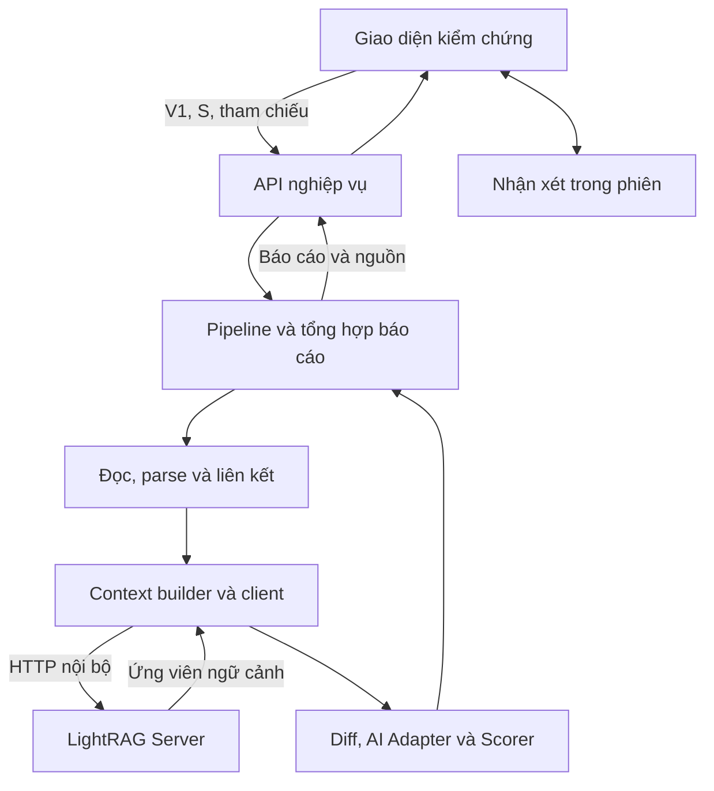

# Architecture — Kiến trúc hệ thống

**Học phần và nhóm:** Problems of Computer Science (POCS) — Nhóm 4  
**Dự án:** Hệ thống hỗ trợ đối chiếu thay đổi văn bản pháp luật với AI có giải thích và có sự kiểm chứng của người dùng  
**Nhóm trưởng:** Dương Đức Anh  
**Thành viên:** Bạch Công Dũng, Dương Đức Anh, Bùi Quang Thọ, Đoàn Ngọc Anh, Đỗ Tuấn Anh  
**Phiên bản:** 1.4.0  
**Tài liệu liên quan:** [BRD](brd.md), [SRS](srs.md), User Research (tài liệu dự kiến, chưa có), [Implementation Plan](implementation-plan.md), [Module](module.md), [Workflow](workflow.md), [Workflow](workflow.md)


Tài liệu xác định kiến trúc mục tiêu và phân công triển khai. Hiện trạng mã nguồn dưới đây là thông tin đã được ghi nhận, chưa phải kết quả nghiệm thu repository đang sử dụng. Schema và fixture trong mã nguồn cần được đồng bộ với hợp đồng mục tiêu trước khi tích hợp; tài liệu không xác nhận các thay đổi mã nguồn đã hoàn thành.

Hợp đồng báo cáo mục tiêu dùng `ComparisonReport.documents/items`, đơn vị hiển thị `ReviewItem` và bốn nhóm phân loại. Danh mục bốn mã, định nghĩa, quy tắc ánh xạ từ dữ liệu nội bộ và ví dụ chuẩn phải được đặc tả thống nhất trong SRS/schema/fixture; tài liệu này không tự đặt mã khi chưa có danh mục cụ thể. Không dùng danh mục tám nhóm khía cạnh của hợp đồng trước làm hợp đồng đầu ra song song.

## 1. Lựa chọn kiến trúc và hiện trạng

Hệ thống tập trung vào người dùng sinh viên Luật: hiểu thay đổi, đọc bằng chứng, nhận biết giới hạn, ghi nhận nhận xét và kiểm tra lại sau bổ sung. Lõi xử lý V1–S cung cấp dữ liệu cho báo cáo, giao diện và đánh giá theo hợp đồng dữ liệu mục tiêu. Chỉ tiêu chất lượng được xác định theo phạm vi và phép đo của hệ thống.

Frontend và backend nghiệp vụ được tách; backend xử lý trong cùng request, frontend giữ file, báo cáo và nhận xét trong phiên. **Đã chốt phương án tích hợp: backend nghiệp vụ gọi LightRAG Server riêng qua HTTP.** Dịch vụ có thể chạy trên cùng máy qua localhost hoặc trên máy riêng được cấu hình; việc chọn phiên bản, endpoint và tham số không thay đổi quyết định tích hợp qua HTTP. Internet chỉ cần theo nơi chạy mô hình/tài nguyên; chưa cam kết offline toàn hệ thống. Phạm vi đầu tiên là retrieval, chưa giao LightRAG sinh ReviewItem hoàn chỉnh hoặc thay linker/scorer.

| Thành phần | Hiện trạng được ghi nhận | Hướng mục tiêu / việc chờ owner |
| --- | --- | --- |
| PDF → DOCX, Parser | Có implementation xử lý đầu vào | Giữ code trước, thêm adapter nguồn; LK-03 |
| API nền | Nhận doc_v1/doc_s/reference_files | Hợp đồng mục tiêu base_file/amendment_file/reference_files; LK-11 |
| Pipeline nền | Đọc/parse, khung báo cáo hiện tại chưa đúng hợp đồng mục tiêu, điểm nối runner | Tổng hợp documents/items theo hợp đồng mục tiêu; validation lồng nhau chưa có |
| Context, schemas, change_analysis | Phần lớn là khung trong cấu trúc nền | Triển khai theo owner và fixture; kiểm tra nhánh tích hợp trước khi tái sử dụng code |
| evaluation/ | Giữ thư mục và file hiện có | Không triển khai Evaluator độc lập; kiểm thử do owner tại từng điểm nối phối hợp |
| Frontend | Khung, chưa có ứng dụng chạy hoàn chỉnh | React/TypeScript là định hướng frontend; môi trường và thư viện cụ thể chốt ở yêu cầu frontend trong SRS |
| LightRAG | Chưa có client, chưa ghi nhận thử nghiệm dịch vụ | Release/API/model/index lifecycle theo LK-13 và CN-04 |
| Test | Thư mục khung tên test/ | Giữ tên test/; owner bổ sung kiểm thử, không đổi tests/ riêng trong docs |

Ba file nền main/pipeline/requirements được ghi nhận đã có trong mã nguồn nền, nhưng chưa đáp ứng schema mục tiêu và thiếu runner phân tích. Đọc/parse hợp lệ hiện báo FAILED/ANALYSIS_NOT_CONFIGURED (HTTP 501). /health chỉ báo API và runner, chưa kiểm tra LightRAG. Chọn công nghệ hoặc có hook không chứng minh đã tích hợp hoặc nghiệm thu.

## 2. Thành phần và ranh giới trách nhiệm



Các module nghiệp vụ gọi nhau bằng hàm/contract; HTTP LightRAG được cô lập trong client. Pipeline không phụ thuộc router hoặc shape response thô của dịch vụ. AI Adapter gọi mô hình và validate kết quả; context client không tự quyết định nhãn pháp lý hay decision người dùng. Log không ghi toàn văn tài liệu, ghi chú hoặc khóa.

| Thành phần | Trách nhiệm | Điểm bàn giao |
| --- | --- | --- |
| Xử lý đầu vào và document_adapter | Chuyển PDF khi cần, parse DOCX; giữ gốc/chuyển đổi, cây, bảng và outside | Dữ liệu nguồn theo document_id/source_ref; contract native/adapter chốt ở LK-03 |
| Amendment linker | Trích chỉ dẫn, văn bản/đích, operation, applicability, trước/sau, hiệu lực | Dữ liệu để phân tích; chưa rõ giữ nguồn/lý do, không tự kết luận thêm/xóa |
| Chunk builder/source registry | Đoạn đủ nghĩa và ánh xạ nguồn | Chunk nội bộ có vai trò/định danh/spans; không coi là payload Server đã chốt |
| LightRAG client | Nhập, theo dõi sẵn sàng, query, lỗi và dọn dữ liệu | Ứng viên retrieval và trạng thái; API cụ thể LK-13 |
| Context builder | Tìm căn cứ theo chỉ dẫn, kiểm tra quote và tài liệu | Ngữ cảnh, ReferenceRequirement, EffectInfo; nguồn vẫn thuộc V1/S/tham chiếu |
| Text Diff | Khác biệt chữ của trước/sau đủ căn cứ | TextChange khớp chuỗi trả frontend |
| Semantic Diff / Scorer / AI Adapter | Nhận định bốn nhóm, giải thích, mức tác động; kiểm tra cấu trúc và quote | Dữ liệu chuyển sang ReviewItem theo hợp đồng mục tiêu, không dùng điểm retrieval làm significance |
| Bộ tổng hợp báo cáo | Giữ cả chỉ dẫn chưa phân tích được, mapping nội bộ và lỗi | ComparisonReport có documents/items và nguồn dùng được |
| Frontend/session | Hiển thị, lọc, ReviewRecord, đối chiếu sau phân tích lại | Dữ liệu người dùng riêng, không ghi đè AI hoặc tự thành gold |

## 3. Cấu trúc mã nguồn và dữ liệu

Cố định cấu trúc chính theo branch `plan_lightrag`: dùng `backend/app/`, `frontend/`, `test/`, `data/`, `deploy/`, `runtime/` và `docs/`. Không tự đổi tên, xóa hoặc chuyển vị trí các folder chính. Danh sách file chính bắt buộc và người chịu trách nhiệm nằm trong [Module](module.md). Owner được thêm file hỗ trợ trong module; đổi cấu trúc hoặc giao diện chung phải được bên bị ảnh hưởng review trước khi tích hợp. Cây dưới là cấu trúc đã chốt, không xác nhận mọi file đã có implementation.

```text
.
├── backend/
│   ├── main.py
│   └── app/
│       ├── pipeline.py
│       ├── api/
│       │   └── compare.py
│       ├── schemas/
│       │   └── contracts.py
│       ├── config.py
│       ├── document_processing/
│       │   ├── pdf_to_docx.py
│       │   ├── parser/
│       │   │   └── legal_structure_parser.py
│       │   ├── document_adapter.py
│       │   └── amendment_linker.py
│       ├── context/
│       │   ├── chunk_builder.py
│       │   ├── source_registry.py
│       │   ├── lightrag_client.py
│       │   └── context_builder.py
│       ├── change_analysis/
│       │   ├── text_diff.py
│       │   ├── semantic_diff.py
│       │   ├── scorer.py
│       │   └── ai_adapter.py
│       └── evaluation/
│           └── evaluator.py       # Giữ cấu trúc, không triển khai riêng
├── frontend/
├── test/
│   ├── unit/
│   ├── integration/
│   ├── e2e/
│   └── fixtures/
├── data/
│   ├── raw/
│   │   └── case_*/
│   ├── test_parser/
│   └── test_pdf_to_docx/
├── deploy/
│   └── lightrag/
├── runtime/
└── docs/
```

Parser hiện tự đọc DOCX, trả dict gồm articles/outside/source_blocks/warnings/status/summary. Node giữ children, segments, full_text, source_refs; không là knowledge graph. Giữ implementation trước, chưa bắt refactor Reader riêng; Thọ chủ trì adapter và mapping nguồn, phối hợp Dũng kiểm tra dữ liệu để Đức Anh/Ngọc Anh/Tuấn Anh sử dụng được. Reference không có Điều nhưng có blocks/bảng vẫn có thể làm căn cứ; native Parser status không thay ComparisonReport.status.

Source_ref hiện là block:N. Offset segment tính theo ký tự Python [start,end) trên text block; node_id không là khóa ghép phiên bản. Với PDF chuyển đổi, chỉ nói đúng nguồn DOCX đã có; mapping trang PDF là đầu ra cần kiểm chứng, không suy từ số block. LK-04 và yêu cầu hiển thị nguồn trong SRS phải xử lý chuyển chỉ số khi frontend dùng quy ước khác.

Chunk nội bộ dự kiến có comparison_id, document_id, role, unit_path, node_ids, text, source_spans và ID nhóm quản lý. Owner quyết định kích thước/cách ghép ở LK-13; không lấy full_text mọi cấp gây lặp hoặc chỉ node lá làm mất câu dẫn. Không mặc định Server nhận cây dict, giữ metadata hoặc không chia lại chunk. Registry phải nối kết quả query với nguyên văn đã cung cấp.

## 4. Luồng phân tích, dữ liệu và phiên

### 4.1. Một lượt phân tích

1. Frontend gửi base_file/amendment_file/reference_files theo hợp đồng mục tiêu; API nền phải được chuyển đổi trước tích hợp toàn hệ thống.
2. Backend cấp comparison_id mới, kiểm tra/lưu file tạm và chạy pipeline. Chuẩn bị nguồn/cây bằng converter/Parser hiện có, adapter theo LK-03.
3. Linker trích yêu cầu và đích; chuẩn bị chỉ mục một lần cho bộ tài liệu trong comparison, chờ nhập hoàn tất rồi mới query.
4. Context builder truy vấn theo yêu cầu, kiểm tra nguồn, ghi căn cứ thiếu/chưa rõ và EffectInfo. Retrieval score hoặc mô tả entity không thay severity/quote.
5. Text Diff chạy khi đủ trước/sau. Semantic Diff/Scorer tạo dữ liệu có căn cứ; bộ tổng hợp chuyển thành ReviewItem, bốn mã phân loại mục tiêu và ComparisonReport theo hợp đồng mục tiêu.
6. Trả nguồn đủ cho frontend đọc bằng chứng sau khi backend dọn tài nguyên. Chưa tạo được nhận định vẫn giữ mục chỉ dẫn và lý do; không che lỗi bằng mảng rỗng.
7. Frontend khởi tạo UNREVIEWED, cho người dùng kiểm chứng và lưu decision/note. Nhận xét không đi ngược thành đáp án AI tự động.

Chỉ mục phục vụ nhiều chỉ dẫn trong một comparison, chưa giữ qua request bổ sung. LK-13 phải kiểm chứng nhập/status/query/mapping/cách ly/xóa ở release cố định. Nếu chưa làm được vòng đời này, chỉ thử một bộ trong môi trường disposable riêng; chưa coi đạt yêu cầu phục vụ nhiều lượt/người dùng.

### 4.2. Bổ sung tài liệu và nhận xét

Gửi lại V1/S cùng tham chiếu cũ/mới trong request đồng bộ mới. Frontend giữ báo cáo/nhận xét cũ và tạm khóa sửa/lưu trong khi chờ; thất bại giữ nguyên bản cũ. Lượt có kết quả dùng được tuân quy tắc mục tiêu: mục mới UNREVIEWED; cùng mục nhưng nội dung đổi RECHECK_REQUIRED, decision hiện tại null và previous_record giữ riêng; chỉ giữ REVIEWED khi xác minh nội dung liên quan không đổi. Không ghép chắc chắn thì giữ nhận xét cũ trong danh sách chưa đối chiếu, không gắn theo số Điều/thứ tự hoặc ID giống nhau.

Lượt mới PARTIAL nhưng dùng được vẫn cần xử lý đối chiếu; FAILED/timeout không thay báo cáo cũ. Hành vi theo đặc tả phiên trong SRS; chi tiết thuật toán/mapping/fixture cần owner liên quan thống nhất trước khi triển khai. Khi chưa chứng minh mapping, dùng phương án yêu cầu kiểm tra lại mọi mục cũ nhận diện được, giữ riêng các mục không ghép được.

### 4.3. Vị trí lưu và vòng đời

| Dữ liệu | Nơi giữ | Vòng đời |
| --- | --- | --- |
| File đã chọn, report/nguồn, ReviewRecord | Frontend | Trong phiên; chưa bảo đảm sau đóng/tải lại tab; cảnh báo trước đổi phiên |
| File gốc/chuyển đổi dùng xử lý | Backend runtime | Theo comparison; dọn khi không còn tác vụ dùng, kể cả lỗi |
| Chỉ mục và cache chứa nội dung | LightRAG/storage đã cấu hình | Cách ly và dọn theo comparison phải kiểm chứng; Server chạy liên tục không có nghĩa dữ liệu được giữ lâu dài |
| Nhãn/gold và dữ liệu nghiên cứu | Bộ dữ liệu được quản lý riêng | Không nhập nhãn, V2 đối chiếu hoặc dữ liệu người dùng vào index ngoài chủ định |
| Log | Backend/dịch vụ | ID, bước, lỗi, thời gian; giới hạn lưu chờ LK-12/LK-13; không toàn văn/ghi chú/khóa |

Không xóa vùng dùng chung của Server để giả lập xóa một comparison. HTTP timeout không tự hủy converter/tác vụ phía dịch vụ. Cần xử lý dữ liệu sót hoặc tác vụ tiếp tục chạy; retry có giới hạn, không tự gửi lặp toàn POST từ frontend.

## 5. API, lỗi và contract

API nghiệp vụ mục tiêu: POST /api/compare, multipart base_file/amendment_file/reference_files, trả ComparisonReport theo hợp đồng mục tiêu và nguồn. Chưa có API lưu nhận xét/job. Mã HTTP/error body, kích thước, cơ chế nguồn và alias nếu muốn hỗ trợ do LK-11/LK-03 chốt trong api-contract.md (chưa có). Không ghi URL/payload LightRAG chưa kiểm chứng như API chính thức của dự án.

Code nền vẫn dùng doc_v1/doc_s và cấu trúc báo cáo chưa đáp ứng hợp đồng mục tiêu; việc tài liệu thống nhất không tự sửa code. Bộ tổng hợp chuyển đổi dữ liệu nội bộ sang documents/items; thiếu module hiện trả 501/ANALYSIS_NOT_CONFIGURED. Mã này là trạng thái phát triển, không phải kết luận “không có thay đổi”. SUCCESS/PARTIAL/FAILED, needs_review và ReviewRecord là ba tầng khác nhau.

Với lỗi từng bước, giữ chỉ dẫn/căn cứ đã có và chỉ PARTIAL khi có kết quả dùng được; không có thì FAILED. Lỗi retrieval không tạo REFERENCE_MISSING chỉ vì query rỗng. Có file nhưng chưa tìm đúng đoạn là UNRESOLVED. Ngoài bốn nhóm giữ nguồn, nêu OUT_OF_SCOPE, không ép nhãn hoặc false/LOW.

## 6. Chủ trì và lựa chọn còn mở

| Owner | Trách nhiệm chính | Quyết định liên quan |
| --- | --- | --- |
| Bạch Công Dũng | Dữ liệu, docs, nghiệp vụ; Pipeline, tích hợp và API; phối hợp AI Adapter với Đức Anh | LK-01, LK-02, LK-11, LK-12, CN-08 |
| Dương Đức Anh | Schema và chuẩn bị context theo phân công hiện có; cùng Dũng phụ trách AI Adapter | LK-03, LK-04, LK-06, CN-03, CN-08 |
| Bùi Quang Thọ | Chuyển đổi, Parser, document_adapter; trích/liên kết chỉ dẫn và hiệu lực | CN-01, CN-02, LK-03, LK-04, LK-05 |
| Đỗ Tuấn Anh | Semantic Change/Semantic Diff và Scorer; frontend/session theo phân công hiện có | CN-06, CN-07, LK-07, LK-08, LK-09, LK-10 |
| Đoàn Ngọc Anh | Text Diff và kiểm thử chéo các điểm nối liên quan | CN-05, LK-05, LK-07 |
| Người gọi/tích hợp LightRAG | Bổ sung sau; không mặc định thuộc Dũng hoặc Đức Anh | CN-04, LK-13 |

Phân công chức năng theo LK-01 trong [decision.md](decision.md). Không mặc định một người sở hữu toàn folder change_analysis khi các chức năng được giao cho nhiều người. Đổi thuật toán nội bộ theo phạm vi owner; đổi contract phải được bên giao/nhận review và cập nhật schema/fixture. Quy trình làm việc, Git và kiểm thử theo [workflow.md](workflow.md); không tạo hệ thống mã quyết định D-xx song song.

Không triển khai thêm database lịch sử, account, cộng tác, job/queue hoặc học lại từ nhận xét ở đợt này. Không triển khai module Evaluator độc lập. Các owner bên giao và bên nhận cùng kiểm thử hợp đồng, review cách sử dụng dữ liệu và thử tích hợp; Dũng điều phối kiểm thử đầu-cuối, Dũng hỗ trợ dữ liệu/nhãn và kiểm tra nghiệp vụ; Dũng chủ trì nghiên cứu khả năng sử dụng; không lấy chất lượng mô hình làm bằng chứng giao diện hiệu quả hoặc ngược lại. React/TypeScript là định hướng frontend, yêu cầu frontend trong SRS xác nhận môi trường và thư viện; giới hạn, mô hình và ngân sách chưa là cam kết.


### Các quyết định triển khai cần hoàn thiện

Phương án LightRAG Server qua HTTP đã được chốt. Các việc sau là chi tiết hiện thực và kiểm chứng trong phương án này:

- Cố định release và xác nhận API nhập tài liệu, trạng thái sẵn sàng, truy vấn, cách ly và xóa dữ liệu; chưa ghi endpoint hoặc payload chưa kiểm chứng thành contract.
- Chọn LLM/embedding, cấu hình storage, thông tin kết nối, timeout/retry và ngân sách tài nguyên.
- Chốt chunking, source registry và fixture ánh xạ quote về đúng nguồn; kiểm chứng dữ liệu không lẫn giữa các comparison.
- Đồng bộ hợp đồng documents/items, bốn nhóm phân loại, ReviewRecord và multipart upload vào SRS/schema/API contract; kiểm thử cả SUCCESS/PARTIAL/FAILED.
- Áp dụng phân công chức năng đã chốt ở LK-01: Ngọc Anh làm Text Diff; Tuấn Anh làm Semantic Change/Scorer; Dũng làm tích hợp/API; Dũng + Đức Anh làm AI Adapter. Người gọi/tích hợp LightRAG bổ sung sau; không tự gán owner toàn folder change_analysis.
- Triển khai bán song song: thống nhất contract, schema và fixture trước; bên nhận phát triển với mock/fixture trong khi bên giao hoàn thiện; tích hợp từng điểm nối, không đợi cả chuỗi xong. Chi tiết theo [Workflow](workflow.md) và [Workflow](workflow.md).


### Phát triển theo hợp đồng và hiện trạng schema

`schemas/contracts.py` trên cấu trúc nền và schema có implementation ở nhánh `feat/ducanh-backend-integration` không được mặc định là cùng phiên bản. Commit schema `36d9727` có `contracts.py`, `validation.py`, `report_validation.py`, dùng báo cáo `base_document/amendment_document/reference_documents/results` và tám nhóm khía cạnh. Đây là implementation hợp đồng trước cần chuyển đổi, chưa phải đầu ra mục tiêu `documents/items`. Không ghi đè code đó bằng file khung; chỉ đưa phần đã review, điều chỉnh và kiểm thử về nhánh tích hợp.

Các cấu trúc `AmendmentItem`, `SemanticChange`, `ChangeAspect` và `ScoringResult` được giữ làm biểu diễn nội bộ/nhãn tham chiếu; tám nhóm khía cạnh nội bộ không phải bốn mã phân loại đầu ra. SRS mục 1.7–1.8 quy định ranh giới tổng hợp và phiên; phải chốt danh mục bốn mã và fixture ánh xạ trước khi đóng băng contract đầu ra. Không tự coi schema trên một branch thành hợp đồng chung cho cả nhóm.

LK-13 được chốt các chi tiết còn lại sau khi các quyết định khác trong decision.md hoàn thành. Việc trì hoãn chi tiết không mở lại phương án LightRAG Server qua HTTP đã chốt. Phần context/chuẩn bị nguồn của Đức Anh không đồng nghĩa đã giao người gọi/tích hợp LightRAG.
