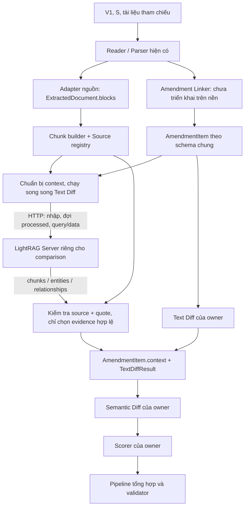
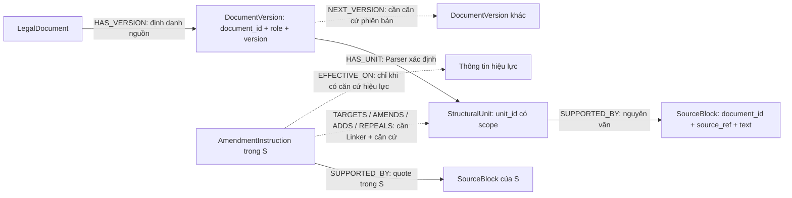
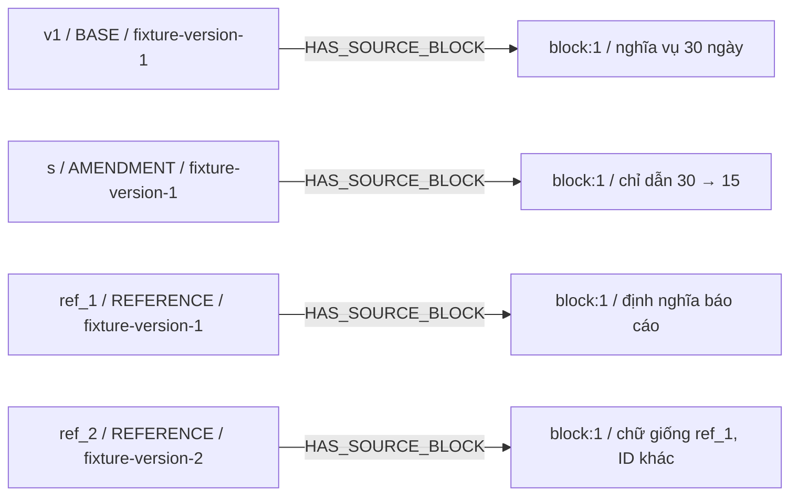

# Báo cáo thử nghiệm LightRAG cho Semantic Diff

**Báo cáo lịch sử ngày 10/11:** giữ bằng chứng theo mốc dưới đây. Các ghi nhận “chưa có Linker/demo” và tracking/đường chạy chỉ thuộc lần khảo sát ban đầu. Nhánh hiện tại đã có demo và sửa lỗi tại c192f43; xem [common-baseline.md](common-baseline.md) để tra trạng thái mới. Sơ đồ thử nghiệm cũ không thay thế luồng mục tiêu index + Text Diff → query trong [architecture.md](architecture.md#411-luồng-mục-tiêu-sau-document-processing-khi-tích-hợp-lightrag).

Ngày thực hiện 10/11/2026. Owner Dũng + Đức Anh. Phạm vi theo yêu cầu thử nghiệm LK-13 trong phiên làm việc này; chưa phải quyết định áp dụng chính thức của cả nhóm.

## 1. Kết quả và giới hạn quan trọng

Đã viết adapter HTTP, registry nguồn, context builder và điểm nối thử nghiệm Context/Text Diff → Semantic Diff. Không đổi schema, validator, route upload hoặc thứ tự nghiệp vụ. Chưa gắn runner phân tích vào API vì các module nghiệp vụ trên nền này chưa có implementation. Gọi API mặc định vẫn không tạo báo cáo phân tích thành công.

Đã chạy demo bằng HTTP contract double, đọc DOCX thật qua Parser, kiểm thử hợp đồng/nguồn/lifecycle và kiểm thử hồi quy schema. **Chưa chạy LightRAG Server thật, chưa nhập/index thật, chưa tạo KG upstream thật, chưa đo chất lượng Semantic Diff hoặc chất lượng truy xuất thật.** Không gọi kết quả giả lập là tích hợp dịch vụ thành công.

Máy kiểm tra không có `.env` hay biến model/embedding/server key liên quan; không có dịch vụ Ollama/LightRAG đang lắng nghe. Docker CLI có sẵn nhưng Docker daemon chưa hoạt động. HTTP probe thực tế được lưu ở `test/fixtures/lightrag/real-service-probe.json`, kết quả `healthy=false`, `retrieval_executed=false`.

## 2. Nền Git và bảo toàn công việc

| Mục | Kết quả |
| --- | --- |
| Nền sau `git fetch origin main` | `f76610e6555572b7a5a8fae5a1e98cf308c3497a` |
| Nhánh mới | `ducanh_bachdung/integrate_LightRAG` |
| Nguồn tạo nhánh | `origin/main`; nhánh đích chưa tồn tại khi kiểm tra |
| Công việc chưa commit trước đó | Hai chỉnh sửa native-parser schema đã cất ở `stash@{0}`, message `wip(schema): preserve native parser edits before LightRAG branch` |
| Nhánh cũ | `feat/ducanh-backend-integration` được giữ nguyên, không lấy làm nền |
| Thao tác xuất bản | Không commit, merge, reset hoặc push |

Nhánh mới đang có upstream tracking là `origin/main` do được tạo từ remote-tracking branch này. Khi được phép push sau này phải chỉ định đúng tên nhánh; không dùng lệnh push mặc định vào main. Stash được giữ, không tự áp lại schema chưa commit vào nền mới.

## 3. Đã chốt, còn mở, đã có và chưa có

| Nội dung | Quyết định/tài liệu | Hiện trạng code tại nền | Phần thử nghiệm này |
| --- | --- | --- | --- |
| Schema Đức Anh | Đã chốt trong SRS/decision/module | contracts và validator có; 2 giới hạn validator đã biết | Giữ nguyên; gọi validation ở ranh giới context |
| LightRAG HTTP | Đã chốt server riêng, chỉ retrieval | Bốn file context và config trống | Thêm client/adapter; chưa kiểm chứng server thật |
| LK-13 chi tiết | decision.md vẫn ghi chờ các quyết định khác | Không có lifecycle | Khảo sát/thử nghiệm theo yêu cầu mới; không sửa thành quyết định nhóm |
| Context song song Text Diff | Kiến trúc mục tiêu | Chưa có runner thực thi | Join opt-in; test kiểm tra chạy song song rồi mới gọi Semantic callback |
| Parser/PDF | Có code | Parse DOCX có; PDF chuyển DOCX | Dùng lại; nguồn PDF vẫn theo DOCX chuyển đổi |
| Linker/Text Diff/Semantic/Scorer | Có phân công và contract | File nghiệp vụ còn khung | Không thay bằng LightRAG hoặc dữ liệu giả |
| Pipeline/API | Có upload/parse và runner hook | Runner mặc định chưa cấu hình; trả 501 sau parse hợp lệ | Chưa tự bật retrieval trong API |
| Model/embedding/storage/limits | Chi tiết chưa chốt chính thức | Không có cấu hình dịch vụ thật | Cấu hình mẫu; giới hạn vận hành cấu hình được, không phải ngưỡng nghiệm thu |
| Chính sách tiếp tục/dừng | LK-12 chốt một phần | Chưa có ma trận tổng hợp đầy đủ | Trả ProcessingIssue và needs_review; owner runner còn phải quyết định trạng thái báo cáo |

Tài liệu đã đọc gồm README, docs/decision.md, module.md, architecture.md, workflow.md, srs.md, schema-integration.md, contracts.py, validation.py, report_validation.py, main.py, pipeline.py và Parser liên quan. `docs/api-contract.md` **không tồn tại** trên nền này; không tạo một hợp đồng API giả để thay thế. Hợp đồng API quan sát được lấy từ code main.py và đối chiếu schema-integration.md/SRS.

Tài liệu nhắc tới `deploy/`, `runtime/` như cấu trúc mục tiêu nhưng chúng chưa có trong checkout nền. Các thư mục này được tạo đúng tên đã nêu để chứa cấu hình và trạng thái thử nghiệm. Tài liệu không phải bằng chứng rằng client, runner hay frontend đã hoàn thành.

## 4. Vị trí gọi và hợp đồng bàn giao



Sơ đồ mô tả điểm nối đã viết và luồng mục tiêu. Các khối ghi owner/chưa triển khai chưa có production implementation trong nhánh này. `run_semantic_stage` thực hiện nhánh context song song Text Diff; chỉ gọi Semantic callback sau khi cả hai hoàn tất. Không đặt LightRAG sau Semantic Diff hoặc thay Text Diff.

| Ranh giới | Input | Output và ảnh hưởng |
| --- | --- | --- |
| Parser → adapter nguồn | list[ParsedDocument] hiện có | list[ExtractedDocument], giữ document_id/role/source_ref/text; chưa thay adapter Clause/linker |
| Nguồn → chunk/index | ExtractedDocument + comparison_id + version manifest nội bộ | SourceChunk nội bộ, file_source băm từ comparison/document/role/version/ref/text |
| LightRAG → registry | data.chunks[].file_path/content | EvidenceRef document_id/source_refs/quote, chỉ khi nguyên văn khớp |
| Context → Semantic | AmendmentItem + context.evidence/general_context bổ sung | Giữ nguyên mọi field schema; giữ reference status/effect_info/before/after/operation |
| Text Diff → Semantic | TextDiffResult | Kiểm tra shape và amendment_id trước gọi Semantic |
| Lỗi retrieval/index | ProcessingIssue hiện có | needs_review và review_reason; không kết luận MISSING hoặc không thay đổi |

`ContextBuild` là đối tượng sổ sách nội bộ, gồm amendment/issues/raw retrieval; không phải envelope bàn giao mới. Semantic callback vẫn nhận AmendmentItem và TextDiffResult. Các tên hàm callback trong bridge là đề xuất wiring thử nghiệm để Dũng/Tuấn Anh review; chưa buộc module owner đổi giao diện.

## 5. Upstream tái sử dụng và API đã đối chiếu

Nguồn [HKUDS/LightRAG](https://github.com/HKUDS/LightRAG), release **v1.5.7**, commit bất biến **28ff1b05f2ac3f3e6fa14dd2cd33656579bd0c9c**. `_version.py` tại pin khai báo core `1.5.7`, API `0344`. Client kiểm tra core version; triển khai lấy source theo commit, không theo tag latest. Health không chứng minh binary chính xác thuộc commit; nguồn build và manifest phải được giữ cùng bản triển khai.

| HTTP API | Căn cứ tại pin | Sử dụng |
| --- | --- | --- |
| GET /health | lightrag/api/lightrag_server.py | core_version, workspace cấu hình đã xác thực, pipeline_busy/active |
| GET /documents/status_counts | document_routes.py | response có `status_counts` lồng bên trong; server phải rỗng trước nhập |
| POST /documents/texts | InsertTextsRequest / InsertResponse | texts, file_sources; response track_id; không gửi metadata tùy ý |
| GET /documents/track_status/{track_id} | TrackStatusResponse | id/file_path/status; đợi đủ nguồn và mọi status processed |
| POST /query/data | QueryRequest / QueryDataResponse | mode, top_k, chunk_top_k, max_total_tokens; lấy raw data, không lấy câu trả lời sinh sẵn |
| GET /graphs | graph_routes.py | label/max_depth/max_nodes; chỉ xuất đồ thị quan sát trong demo thật |
| DELETE /documents/delete_document | DeleteDocRequest | doc_ids đã ánh xạ; thao tác nền, cần poll xác nhận; không gọi xóa toàn bộ |

Mã tham khảo trực tiếp [query_routes.py](https://github.com/HKUDS/LightRAG/blob/28ff1b05f2ac3f3e6fa14dd2cd33656579bd0c9c/lightrag/api/routers/query_routes.py), [document_routes.py](https://github.com/HKUDS/LightRAG/blob/28ff1b05f2ac3f3e6fa14dd2cd33656579bd0c9c/lightrag/api/routers/document_routes.py), [graph_routes.py](https://github.com/HKUDS/LightRAG/blob/28ff1b05f2ac3f3e6fa14dd2cd33656579bd0c9c/lightrag/api/routers/graph_routes.py), [server](https://github.com/HKUDS/LightRAG/blob/28ff1b05f2ac3f3e6fa14dd2cd33656579bd0c9c/lightrag/api/lightrag_server.py).

API có hỗ trợ workspace header ở một số vị trí, nhưng adapter không suy từ đó rằng mọi route nhập/query/xóa đều được cách ly. Không sử dụng workspace động. Không giả định custom metadata được server giữ. file_sources là cầu nối được kiểm tra, không phải bộ lọc bảo mật.

`/query/data` không sinh câu trả lời cuối nhưng mode mix/hybrid vẫn có thể gọi LLM trích keyword. Nhập dữ liệu cũng cần LLM/embedding. Chọn endpoint data không đồng nghĩa chạy được khi thiếu model/key.

### Danh sách file lấy từ GitHub và lý do

Không chép hoặc sửa Python upstream vào backend. Server/index/KG/provider binding được tái sử dụng nguyên bản qua remote Docker build ở commit cố định. Compose/env là cấu hình của dự án dựa trên ví dụ upstream. Giấy phép MIT upstream được giữ ở `deploy/lightrag/UPSTREAM-LICENSE.txt`.

| File upstream | Cách dùng |
| --- | --- |
| Dockerfile, docker-entrypoint.sh | Dùng nguyên bản khi build/chạy image; Dockerfile đã đọc, entrypoint do Dockerfile gọi |
| lightrag/ | Gói server, extraction, graph, retrieval, storage; ở container, không vendor vào backend |
| pyproject.toml, uv.lock | Dependency/build của upstream trong image; pyproject đã đọc; uv.lock được Dockerfile dùng |
| docker-compose.yml | Đã đọc để tham khảo volume/port/entrypoint; local compose đổi thành remote build và vùng dữ liệu riêng |
| env.example | Đã đọc; local env chỉ giữ nhóm biến cần cho thử nghiệm và placeholder |
| routers/query_routes.py, document_routes.py, graph_routes.py | Đã tải để đối chiếu API và response, không chép implementation |
| api/config.py, api/lightrag_server.py | Đã tải để đối chiếu cấu hình, workspace và health |
| __init__.py, _version.py | Đối chiếu version runtime |
| LICENSE | Chép nguyên văn thành UPSTREAM-LICENSE.txt, không đổi copyright |

Danh mục có thể kiểm tra bằng máy nằm ở `deploy/lightrag/upstream-manifest.json`. Không có fork thuật toán upstream. Base image của Dockerfile upstream vẫn dùng tag; việc ghim commit nguồn chưa ghim toàn bộ image digest hoặc dịch vụ model bên ngoài.

## 6. Knowledge graph và truy nguồn

### Mô hình nghiệp vụ đề xuất, chưa triển khai đầy đủ



Nét đứt là quan hệ nghiệp vụ còn cần xác định, không phải quan hệ đã rút ra trong demo. Không tự kết luận AMENDS, REPEALS hoặc hiệu lực từ similarity. Quan hệ suy ra nếu phát triển sau phải có nhãn suy luận, bằng chứng và review; không ghi ngang hàng căn cứ trực tiếp.

### Đồ thị đã chạy trong phiên bản này

`SourceRegistry.source_graph()` tạo **đồ thị truy nguồn của dự án** với 4 DocumentVersion, 4 SourceBlock và 4 cạnh HAS_SOURCE_BLOCK trên dữ liệu demo. Đây là cấu trúc xác định từ input, **không phải KG trích xuất bởi LightRAG**. Bản đầy đủ với ID/quote nằm trong `contract-demo.json → project_source_graph`.



Tên block/Điều trùng nhau không phải khóa gộp. ID đồ thị nguồn và file_source được băm từ định danh có scope comparison/document/role/version. Version do caller cung cấp qua manifest nội bộ; adapter không tự suy version/hiệu lực từ filename. Shared contract chưa có version field riêng nên manifest giữ sidecar, không thêm trường vào schema.

KG upstream chứa entity/relation do mô hình trích xuất, có thể gộp thực thể cùng tên hoặc diễn giải sai. Header nguồn không bảo đảm mô hình không gộp node. Phiên bản này giữ định danh riêng ở registry/đồ thị nguồn, **chưa chứng minh upstream KG tránh gộp các Điều cùng tên**. Vì vậy không đưa description/entity/relation vào context như bằng chứng. Cần chạy thật, xem KG và chỉnh cấu hình extraction nếu kết quả chưa đạt trước khi xét áp dụng chính thức.

### Đường đi có thể kiểm tra

1. Input Reader có `ref_1`, `block:1`, nguyên văn định nghĩa báo cáo.
2. build_chunks thêm header định danh, sinh `pocs_<sha256>.txt`; nguyên văn không bị thay thế.
3. POST /documents/texts gửi indexed_text và file_source; track_status ánh xạ file_path ↔ server doc ID và xác nhận processed.
4. query/data trả chunk có file_path/content; registry bắt buộc khớp đúng file_source, không dò basename hoặc đoán tài liệu theo quote.
5. Chỉ gỡ đúng header của chính record đó; phần còn lại phải là substring nguyên văn trong block của record. Server chia nhỏ vẫn chỉ được chấp nhận khi chunk là đoạn nguyên văn xác định được; chunk lẫn header/nguồn bị từ chối.
6. validate_sources kiểm tra EvidenceRef với Reader output; context nhận document_id/source_refs/quote. Semantic callback chỉ được gọi sau join.

Bước 1 và kiểm tra nguồn đã chạy bằng code dự án; HTTP bước 3–4 trong demo đã chạy với contract double. Đường index/KG/retrieval upstream thật chưa chạy. `upstream_extracted_graph=null` trong artifact là chủ ý, không thay bằng đồ thị giả.

## 7. Vận hành, cách ly, lỗi và cleanup

- Mỗi comparison dùng một LightRAG process/storage riêng, workspace rõ và endpoint riêng. Kiểm tra version/workspace/idle/counts rỗng trước nhập. Phải cấm client khác truy cập instance này trong suốt phiên; health/counts không cung cấp khóa độc quyền ở phía server.
- Server được đặt chỗ bằng file tạo độc quyền trong `runtime/lightrag/leases`. Tất cả worker backend phải dùng cùng thư mục bền vững. Đặt chỗ không tự xóa sau cleanup/crash; lần sau bị SERVER_RESERVED. Đây là giới hạn cố ý của thử nghiệm, chưa phải pool production.
- Không thể dùng nhiều ledger directory, alias URL hoặc nhiều instance backend độc lập để coi cùng server là tài nguyên riêng. DNS aliases/reverse proxy/cùng storage phía sau endpoint không được client tự chứng minh cách ly. Deployment phải bảo đảm URL chuẩn, volume tách riêng và truy cập độc quyền; thử thật còn chờ.
- Hai comparison đồng thời trong test dùng hai server double khác nhau. Chứng minh này chỉ áp dụng logic adapter với cấu hình tách server, không chứng minh cách ly LightRAG thật.
- Index đợi đủ record của track và mọi status processed; không query khi pending/failed/unknown. File_path và server ID phải một-một. Index lặp cùng phiên không gửi lại POST, kể cả hai lời gọi đồng thời. Khác phiên bị chặn bởi reservation.
- Chỉ GET retry tối đa một lần cho lỗi mạng/502/503/504. Không retry POST nhập/query hoặc DELETE mù. Mất ACK nhập giữ trạng thái không chắc chắn; không tự gửi lại hoặc đoán ID để xóa.
- Có timeout từng HTTP call, deadline tổng, giới hạn response bytes, top_k/token/chunk/chars. Deadline là hợp tác ở client; không bảo đảm hủy công việc mô hình đã chạy phía server. Cleanup có ngân sách riêng mặc định 10 giây.
- Cleanup chỉ gửi doc_ids đã đối soát nguồn thuộc track; không gọi DELETE toàn kho. Phải đủ mapping, trạng thái terminal; sau deletion_started tiếp tục poll track rỗng, health idle và counts rỗng. Nếu thiếu xác nhận thì CLEANUP_PENDING, giữ ledger/instance cách ly.
- Không có janitor tự phục hồi sau crash trong phiên bản này. Khi mất ACK hoặc CLEANUP_PENDING, Dũng/Đức Anh phải đối soát track/source trên đúng instance; không xóa kho dùng chung hoặc chỉ xóa ledger để mở lại server cũ.
- Retirement an toàn là ngừng đúng instance của comparison và lưu ledger để đối soát; provision instance/volume mới cho lượt khác. Việc hủy volume cũ cần kiểm tra đúng project/storage; mã này không tự làm.
- Config backend không in API key trong repr/log; không log body/quote/response lỗi. Server key, LLM key và embedding key là các cấu hình khác nhau, đưa qua môi trường. Trace/artifact chứa toàn văn mẫu chỉ được ghi bởi demo với tài liệu giả định.

### Truyền trạng thái hiện tại

| Ca | Hành vi |
| --- | --- |
| Tắt retrieval | Giữ nguyên context và item; không phát sinh kết luận mới |
| Có retrieval hợp lệ | Bổ sung quote nguồn vào general_context/evidence; không sửa operation/after_text/effect_info |
| Query rỗng | RETRIEVAL_EMPTY_UNCONFIRMED + needs_review; giữ references, không chuyển MISSING |
| Sai nguồn/quote | Từ chối toàn bộ bổ sung của lượt query; RETRIEVAL_SOURCE_REJECTED |
| Timeout/lỗi HTTP/index | Giữ mã lỗi an toàn trong ProcessingIssue; needs_review; giữ context cũ |
| Cleanup chưa xác nhận | CLEANUP_PENDING; ledger còn giữ; runner phải truyền issue lên report |

Bridge có thể tiếp tục Semantic với context cũ và needs_review trong thử nghiệm. Owner runner vẫn cần chốt dừng/tiếp tục theo mức độ phụ thuộc, rồi gọi validate_amendment/validate_report và tổng hợp PARTIAL/FAILED đúng LK-12. Không mặc định mọi warning đều PARTIAL; không tuyên bố SUCCESS từ bridge.

## 8. Chức năng và logic các file bổ sung

| File/hàm | Chức năng hiện tại |
| --- | --- |
| config.py / LightRAGConfig | Đọc env; kiểm tra URL/workspace/limits; giấu key khỏi repr |
| chunk_builder.py / documents_from_parsed | Chỉ ánh xạ source_blocks thật sang ExtractedDocument; giữ nguồn chuyển DOCX của PDF |
| chunk_builder.py / build_chunks | Một Reader block một record, băm ID có version/scope; chặn nguồn trùng/quá giới hạn |
| source_registry.py / evidence | Đối chiếu exact file_source và nguyên văn; gọi validator nguồn |
| source_registry.py / source_graph, manifest | Xuất đồ thị truy nguồn xác định và mapping; không tạo KG pháp lý |
| lightrag_client.py | Reservation bền vững, verify/index/track/query/graph/targeted cleanup; giữ lỗi không chắc chắn |
| context_builder.py / prepare_context | Index idempotent rồi retrieval; giữ mã lỗi index tại ranh giới context |
| context_builder.py / build_context | Tạo query, kiểm tra toàn bộ chunks, chỉ bổ sung context có quote; không đổi reference status |
| semantic_bridge.py / run_semantic_stage | Chạy context và Text Diff song song, join, validate shape/ID, gọi Semantic callback |
| pipeline.py | Cập nhật mô tả thành phần chưa nối; không bật runner hoặc đổi chữ ký |
| context_suite/support.py | HTTP contract double có nhãn rõ; chỉ dùng test/demo |
| context_suite/demo.py | Input/output mẫu, so sánh on/off, probe thật và chế độ real không mock |
| test_context.py / test_real_service.py | Kiểm thử hợp đồng/nguồn/lifecycle và kịch bản dịch vụ thật opt-in |

Các module ngoài scope vẫn giữ chức năng ở mục 3. Không bổ sung thuật toán Linker, Text Diff, Semantic Diff, Scorer hoặc báo cáo AI giả.

| Module hiện có ngoài context | Logic chính đang có trên nền |
| --- | --- |
| backend/main.py | FastAPI nhận upload V1/S/tham chiếu, giới hạn kích thước/số file/deadline, khóa comparison trong process, lưu tạm và gọi Pipeline; runner mặc định None |
| app/pipeline.py | Kiểm tra ID/vai trò, parse từng tài liệu, giữ cảnh báo, gọi runner được truyền vào và tổng hợp envelope/lỗi; chưa tự chạy nghiệp vụ phân tích |
| document_processing/pdf_to_docx.py | Chuyển PDF thành DOCX để Parser đọc; chưa xác nhận mapping về trang PDF gốc |
| document_processing/parser/legal_structure_parser.py | Đọc paragraph/table, giữ source_blocks và segments offset, tách cấu trúc Điều/cây và cảnh báo; không trích/liên kết đầy đủ chỉ dẫn sửa đổi |
| document_processing/document_adapter.py | File nền còn trống; adapter nguồn hẹp của thử nghiệm nằm trong chunk_builder, chưa thay adapter Clause theo LK-03 |
| amendment_linker / change_analysis | Các file nghiệp vụ còn khung; contract không chứng minh thuật toán đã chạy |
| schemas/contracts.py, validation.py, report_validation.py | Kiểu dữ liệu và kiểm tra shape/nguồn/amendment/report, cùng tám nhóm khía cạnh và scoring; runner phải gọi đúng validator |
| frontend / evaluation | Chưa có sản phẩm frontend hoàn chỉnh; không triển khai Evaluator riêng theo phân công hiện tại |

## 9. Hướng dẫn chạy

Chạy từ repo root, dùng môi trường Python hiện có. Dependency schema theo requirements.txt, HTTP client tùy chọn theo requirements-lightrag-client.txt. Ca Parser DOCX cần python-docx của môi trường runtime Parser; nếu dựng môi trường mới, cài `python-docx==1.2.0` trước khi chạy bộ context test. Dịch vụ LightRAG có môi trường riêng trong container, không cài toàn bộ upstream vào backend.

```powershell
python -m pip install -r requirements.txt -r requirements-lightrag-client.txt
python -m unittest discover -s test/context_suite -v
python -m unittest discover -s test/schema_suite -v
python -m test.context_suite.demo --mode contract --output test/fixtures/lightrag/contract-demo.json
python -m test.context_suite.demo --mode probe --output test/fixtures/lightrag/real-service-probe.json
```

Demo contract mặc định dùng ledger tạm và transport giả lập, có thể chạy lại. Demo thật dùng ledger bền vững và không tự giải phóng reservation. Không xóa ledger thật chỉ để chạy test lần nữa.

### Chuẩn bị server thật

1. Bật Docker engine. Sao chép `deploy/lightrag/.env.example` thành `.env` cùng thư mục; điền server key, model/provider/embedding hợp lệ và dimension khớp model. Các placeholder không phải cấu hình có thể chạy ngay.
2. Giữ WORKSPACE riêng, port riêng và Compose project riêng cho comparison. Dùng storage Json/NetworkX/NanoVector trong mẫu; không trỏ shared database ngoài khi chưa kiểm chứng scope.
3. Build source upstream cố định và khởi chạy instance.

```powershell
docker compose -f deploy/lightrag/compose.yaml --env-file deploy/lightrag/.env config --quiet
docker compose -p pocs-comparison-a -f deploy/lightrag/compose.yaml --env-file deploy/lightrag/.env up --build -d
```

Compose đã được kiểm tra cú pháp bằng `config --no-env-resolution --quiet` với env.example; **chưa build hoặc khởi động**. Dòng lệnh build cần Internet để lấy upstream/dependencies. Cấu hình mẫu không cam kết mô hình nào phù hợp hoặc chi phí nào được nhóm duyệt.

4. Đặt biến backend theo `backend/.env.lightrag.example` vào process environment; mã không tự đọc file dotenv. `POCS_LIGHTRAG_API_KEY` phải bằng key server, không phải khóa provider. Với server mẫu, URL là localhost:9621, workspace pocs_comparison_a. Có thể dùng cơ chế môi trường của IDE/terminal để tránh ghi key trong lịch sử lệnh.
5. Probe lại, rồi đặt `POCS_LIGHTRAG_REAL_TEST=1` **chỉ cho instance disposable chuyên biệt**. Chọn chạy demo thật hoặc test thật, không chạy cả hai nối tiếp trên cùng server/reservation đã dùng.

```powershell
python -m test.context_suite.demo --mode real --output runtime/lightrag/real-demo.json
# Hoặc thay cho demo, trên instance mới chưa được đặt chỗ
python -m unittest test.context_suite.test_real_service -v
```

Real demo lưu raw retrieval, raw `/graphs`, mapping nguồn, context, latency/consistency và cleanup issue. Nếu retrieval không có căn cứ hợp lệ, artifact giữ issue/failure; không thay bằng mock.

### Kiểm tra hai comparison thật đồng thời

Provision instance B với port 9622, workspace pocs_comparison_b và project `pocs-comparison-b`; cần env file riêng có cùng định dạng mẫu. Ví dụ file `.env.b` đặt `POCS_LIGHTRAG_SERVER_ENV_FILE=.env.b`, rồi dùng `--env-file deploy/lightrag/.env.b` khi chạy Compose. Biến này chọn đúng file đưa provider key/model vào container B; không chỉ đổi port ở shell. Tên Compose project khác tạo named volumes khác. Đặt POCS_LIGHTRAG_URL_2/WORKSPACE_2/API_KEY_2 cho backend. Hai instance đều phải mới và chưa từng được runner/test đặt chỗ. Test concurrent sẽ chạy thay kịch bản single-instance; server A không bị dùng trước bởi single test trong cùng lần chạy.

```powershell
python -m unittest test.context_suite.test_real_service.RealServiceTests.test_real_two_servers_concurrent_and_cross_source_rejection -v
```

### Điểm ghép cho Dũng/Tuấn Anh review

Trong analysis_runner thật, sau Linker, dùng documents_from_parsed và version manifest đã xác nhận để tạo một registry và một client cho comparison. Với từng item, gọi bridge tuần tự theo item; nhánh context của item chạy song song nhánh Text Diff. Không cleanup trong từng query; cleanup sau toàn comparison và sau khi mọi callback đã kết thúc.

```python
# Wiring minh họa; text_diff_impl/semantic_diff_impl là module thật của owner.
issues = []
try:
    context, text_result, semantic_result = run_semantic_stage(
        item,
        context_work=lambda current: prepare_context(current, registry, client),
        text_diff=text_diff_impl,
        semantic_diff=semantic_diff_impl,
    )
    issues.extend(context.issues)
    # Dùng context.amendment; gọi scorer, validate_amendment và validate_report.
    # Runner tổng hợp AnalysisOutcome theo chính sách LK-12 đã được nhóm chốt.
finally:
    cleanup_code = client.cleanup()
    if cleanup_code:
        issues.append({"stage": "context", "code": cleanup_code,
                       "message": "LightRAG cleanup requires reconciliation.",
                       "amendment_id": None})
```

Ví dụ chưa phải runner hoàn chỉnh; không gắn callback giả vào API. Client index có khóa chống gọi nhập trùng trong cùng phiên; không gọi cleanup đồng thời index/query và không dùng cùng client cho comparison khác.

## 10. Kết quả demo và đánh giá bật/tắt

Input/output đầy đủ ở `test/fixtures/lightrag/contract-demo.json`. Đây là bốn tài liệu giả định, một chỉ dẫn đổi 30 ngày thành 15 ngày; trước/sau do fixture cung cấp, không do LightRAG tự dựng. ref_2 có cùng chữ với ref_1 nhưng khác ID/version để kiểm tra giữ nguồn riêng. Truy vấn cần định nghĩa từ ref_1:block:1; gold mẫu được khai báo rõ trong artifact.

| Chỉ tiêu | Tắt bổ sung retrieval | Bật contract double | Ý nghĩa |
| --- | --- | --- | --- |
| Số nguồn trong context.evidence | 1 | 4 | Nguồn được validator đối chiếu |
| Recall nguồn với gold ref_1:block:1 | 0 | 1 | Chỉ trên một mẫu giả định |
| Precision nguồn với cùng gold | 0 | 0.25 | Double trả cả distractor; không chứng minh ranking tốt |
| Quote truy nguồn được | 1/1 | 4/4 | Tính đúng mapping, không phải tính đúng pháp lý |
| Lặp query | Không gọi server | 3 lần, context giống nhau | Tính ổn định double, chưa đo model thật |
| KG upstream | Không có | null | Không tạo đồ thị giả thay dịch vụ |
| Semantic/legal accuracy | Chưa đo | Chưa đo | Chưa có module/model thật để so sánh |

Độ trễ từng lần, thời gian index, raw retrieval và enabled/disabled context nằm trong JSON. Các số millisecond của contract double chỉ phản ánh overhead cục bộ; không thể dùng dự báo độ trễ hoặc chi phí provider thật. Không tự đặt ngưỡng nghiệm thu chính thức.

Artifact chứng minh code adapter phiên bản đầu có thể nhận input hiện hành, kiểm tra quote, tạo output context và thực hiện lifecycle theo response contract giả lập. Artifact không chứng minh LightRAG upstream đã chạy. HTTP probe thật không kết nối được; cần cung cấp dịch vụ/model hợp lệ để có KG thật và so sánh hữu ích/chi phí thật.

## 11. Kiểm thử và bằng chứng

| Nhóm | Kết quả | Phạm vi |
| --- | --- | --- |
| Context suite | 26 test, 24 đạt, 2 skipped | Contract double + adapter + Parser DOCX thật; 2 ca real chưa chạy |
| Real service suite | 2 kịch bản bị skip khi thiếu opt-in/service | Có mã cho nhập/query/KG/cleanup và hai server đồng thời; chưa thực thi |
| Schema suite gốc | 51 test, 49 đạt, 2 expected failures | Không đổi schema/validator; lỗi đã biết về change ID toàn cục và tái dựng toàn văn |
| Compose config | Đạt | Cú pháp/biến cấu hình; không kiểm chứng image/server/model |
| Probe thật | Không kết nối được | Có artifact, không dùng mock |

Các ca context bao gồm nguồn foreign/path giả, quote diễn giải thay nguyên văn, trùng document_id/source_ref, cùng nội dung khác document/version, query trước ready, pending vượt deadline, empty/timeout, lost upload ACK không retry, server sai version/workspace/có dữ liệu, response quá lớn, nhập trùng đồng thời, hai comparison khác server, cleanup busy/quarantine, thứ tự join trước Semantic và DOCX Parser → registry.

Giới hạn test hiện có là fault injection dùng double; chưa có proxy lỗi trên server upstream thật, chưa kiểm chứng crash recovery, provider rate-limit hoặc chất lượng KG trên bộ văn bản pháp luật thật. Chạy lại bằng dịch vụ thật trước khi nghiệm thu LK-13.

## 12. Hướng phát triển và quyết định còn cần chốt

1. Dũng + Đức Anh cấp hai môi trường LightRAG disposable cùng model/embedding/key được duyệt; chạy real demo và concurrency test, lưu raw KG/trace và xác nhận không lẫn/xóa nhầm.
2. Thọ bàn giao Clause/linker và version manifest có căn cứ; review block chunking để điều dài không bị mất ngữ cảnh. Phiên bản này dừng khi block vượt giới hạn, chưa tự chọn thuật toán cắt điều.
3. Tuấn Anh review callback context/Text Diff → Semantic; chạy cùng bộ V1–S có gold, so sánh retrieval on/off ở mức Semantic/aspect/evidence. Ngọc Anh cung cấp TextDiffResult thật cho join.
4. Chốt chính sách scope/pool/retirement/janitor và xử lý mất ACK/crash. Thử nghiệm một server/comparison an toàn có chi phí cao; chưa chọn shared workspace production.
5. Kiểm tra KG trích xuất có gộp nhầm Điều/phiên bản không; chỉ sau khi có bằng chứng mới quyết định prompt/custom extraction hoặc phạm vi KG dùng được. Giữ tách graph nguồn xác định và graph suy ra.
6. Lập bộ mẫu gồm Điều liên quan, version cũ/mới, chỉ dẫn sửa đổi, hiệu lực có/thiếu nguồn, distractor và sai định danh. Đo source precision/recall, semantic accuracy, completeness, latency p50/p95, stability và traceability trên cùng dữ liệu; nhóm chốt ngưỡng sau đo.
7. Chốt LK-12 và wiring runner/validator, rồi mới bật option trong API. Không dùng mock hoặc context rỗng để che module còn thiếu.

## 13. File thay đổi

- Sửa README.md, .gitignore, backend/app/config.py và mô tả wiring trong backend/app/pipeline.py.
- Điền bốn file context có sẵn; thêm context/__init__.py và semantic_bridge.py.
- Thêm backend/.env.lightrag.example, requirements-lightrag-client.txt.
- Thêm deploy/lightrag/compose.yaml, .env.example, upstream-manifest.json, UPSTREAM-LICENSE.txt.
- Thêm test/__init__.py, test/context_suite/ gồm support/demo/contract test/real test.
- Thêm test/fixtures/lightrag/contract-demo.json và real-service-probe.json.
- Thêm chính báo cáo này. Không sửa contracts.py, validation.py hoặc report_validation.py; không đổi quyết định nhóm trong decision.md.

Trạng thái cuối của kiểm thử context và số liệu thời gian được ghi ở mục 14 sau lần xác nhận cuối.

## 14. Xác nhận cuối ngày 10/11/2026

- Môi trường chạy Python 3.14.8, httpx 0.28.1, Pydantic 2.13.4.
- `python -B -m unittest discover -s test/context_suite -v` đã chạy 26 test trong khoảng 0.696 giây, 24 đạt và 2 skipped do chưa có dịch vụ thật/opt-in.
- `python -B -m unittest discover -s test/schema_suite -v` đã chạy 51 test, 49 đạt và 2 expected failures vốn có; không có lỗi hồi quy mới.
- `docker compose ... config --no-env-resolution --quiet` trả exit code 0; không build image, không khởi chạy server.
- Demo cuối có nhãn `CONTRACT_DOUBLE_NOT_LIGHTRAG`, tạo lúc `2026-11-10T16:18:55.187352+00:00`. Tắt retrieval khoảng 2.293 ms; index double khoảng 5.001 ms; ba lần query/context khoảng 6.807 / 8.718 / 5.936 ms. Context giống nhau qua ba lần. Các số này chỉ đo double cục bộ.
- Artifact có 8 node và 4 cạnh của đồ thị truy nguồn dự án, 4 EvidenceRef hợp lệ, `failure=null`, `cleanup_issue=null`; KG upstream vẫn null.
- Probe dùng HTTP thật ghi `SERVER_UNAVAILABLE_OR_INVALID_RESPONSE`; chưa chạy nhập/index/query/KG thật hoặc đo độ chính xác, đầy đủ và chi phí của LightRAG trên dữ liệu pháp luật thật.
- `git diff --check` không có lỗi whitespace. Không có diff trong backend/app/schemas. HEAD vẫn là commit nền f76610e6555572b7a5a8fae5a1e98cf308c3497a; thay đổi đang nằm local, chưa commit/push.
